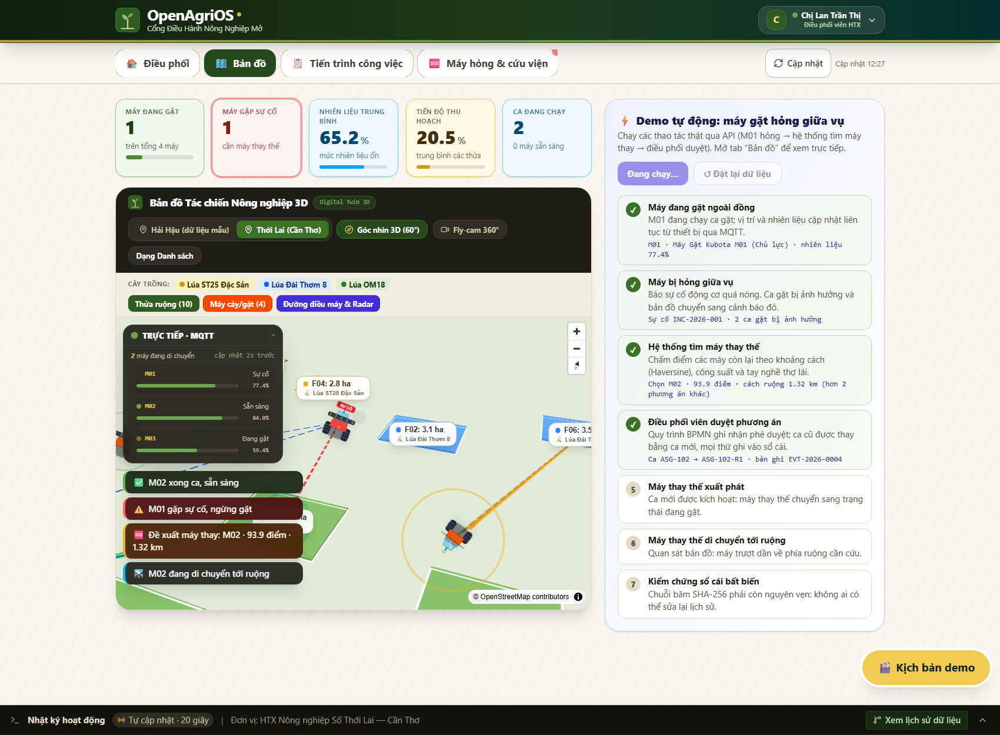
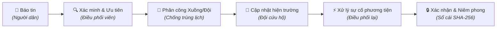
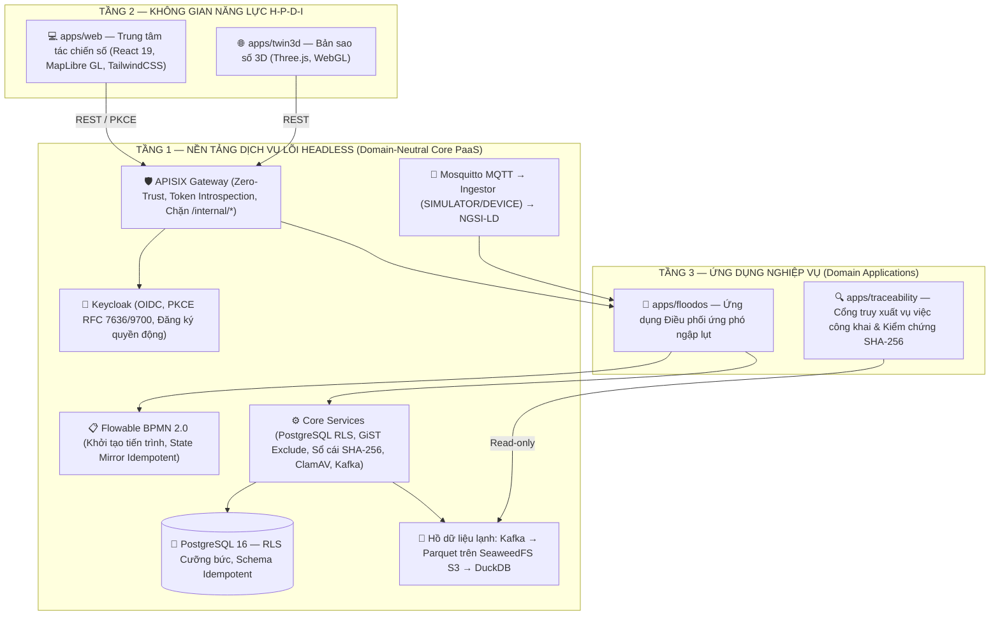
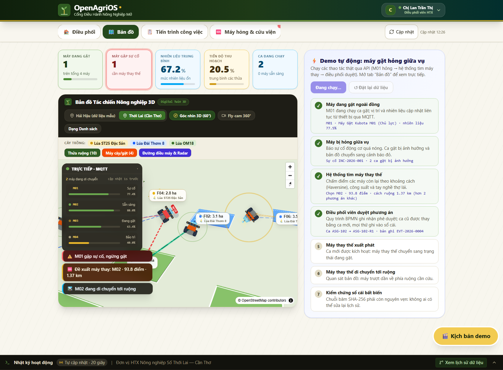

<div align="center">

<a href="https://github.com/Floodos-hou/FloodOS">
  
</a>

# FloodOS

### Hệ điều hành Chuyển đổi số mã nguồn mở (DX-OS Open-Core) điều phối ứng phó ngập lụt đô thị
*An Open-Core Digital Transformation Operating System for Urban Flood Response Coordination*

[](LICENSE)
[](pom.xml)
[](docs/architecture.md)
[](core/data-services/NgsiLdTwinMapper.java)
[](infra/gateway/apisix.yaml)
[](https://github.com/Floodos-hou/FloodOS/releases)

---

**Bài dự thi OLP 2026 — Khối Phần mềm nguồn mở**  
*Chủ đề: Xây dựng Hệ điều hành Chuyển đổi số bằng Công nghệ Lõi nguồn mở (DX-OS Open-Core)*  
**Địa bàn thí điểm:** Hà Nội | **Mã nguồn:** 100% Nguồn mở theo chuẩn Apache-2.0

[Tổng quan](#-tổng-quan-và-câu-chuyện-ứng-cứu) •
[Kiến trúc 3 tầng](#-kiến-trúc-hệ-thống-dx-os-open-core) •
[Giao diện tác chiến](#-trung-tâm-chỉ-huy-tác-chiến-giao-diện-demo) •
[Phân quyền 5 vai trò](#-bảng-phân-quyền-tác-chiến-5-vai-trò) •
[Minh bạch dữ liệu](#-bản-đồ-trạng-thái-minh-bạch-honesty-matrix) •
[Cài đặt nhanh](#-khởi-chạy-nhanh-trong-3-phút) •
[Kiểm thử](#-kiểm-thử-toàn-diện)

</div>

<br>

<p align="center">
  
</p>

---

## 🎯 Tổng quan và câu chuyện ứng cứu

Khi xảy ra ngập úng đô thị hoặc lũ lụt cục bộ, bài toán cốt lõi của chính quyền và lực lượng cứu nạn cứu hộ là **điều phối tài nguyên kịp thời, chính xác, không chồng chéo và minh bạch dấu vết**. 

**FloodOS** hiện thực hóa một chu trình ứng cứu khép kín 6 bước trên nền tảng **DX-OS Open-Core**:



### 📖 Một ca cứu nạn thực tế trên hệ thống (End-to-End Golden Flow)

1. **Người dân gửi tin báo:** Người dân tại Hà Nội gửi tin báo ngập qua giao diện web di động (nước sâu 55 cm, 5 người cần sơ tán kèm ảnh chụp hiện trường). Hệ thống tự động quét mã độc bằng ClamAV (fail-closed) và gắn vào vùng ngập lân cận theo thuật toán khoảng cách Haversine.
2. **Điều phối viên thẩm định:** Điều phối viên duyệt tin, đặt mức độ khẩn cấp `URGENT`, chọn **Xuồng cứu hộ V02** và **Đội phản ứng nhanh T02**. Thuật toán chống xếp trùng lịch GiST của PostgreSQL và lõi Java lập tức kiểm tra khung giờ; nếu tài nguyên đang bận sẽ trả về lỗi `409 Conflict`.
3. **Đội hiện trường tác nghiệp:** Đội hiện trường nhận lệnh trên thiết bị di động, bấm nhận lệnh (`IN_PROGRESS`). Khi xuồng gặp sự cố hỏng chân vịt, đội trưởng gửi báo cáo sự cố ngay tại hiện trường.
4. **Hệ thống đề xuất phương án thay thế có giải thích:** Động cơ xếp hạng cứu nạn tự động tính điểm các phương tiện khả dụng dựa trên 4 tiêu chí minh bạch: *Khoảng cách Haversine (40đ) + Độ phù hợp phương tiện (25đ) + Sức chứa cứu hộ (20đ) + Đánh giá đội (15đ)*.
5. **Điều phối viên phê duyệt:** Điều phối viên chủ động bấm chọn phương án tối ưu. Lệnh cũ chuyển sang `SUPERSEDED`, lệnh mới `-R1` kế thừa mã vụ việc (`correlation_id`).
6. **Xác nhận & Niêm phong sổ cái:** Sau khi hoàn thành nhiệm vụ, người dân bấm xác nhận kết quả. Toàn bộ tiến trình được mã hóa vào sổ cái bất biến SHA-256 nối chuỗi; cổng thông tin công khai Tầng 3 tự tính toán lại chuỗi băm để chứng minh tính trung thực mà không phụ thuộc vào máy chủ cơ sở dữ liệu.

---

## 🏛️ Kiến trúc hệ thống: DX-OS Open-Core

FloodOS tuân thủ tuyệt đối quy tắc **tách biệt ranh giới** theo đề thi OLP 2026: Lõi nền tảng PaaS không chứa bất kỳ thuật ngữ hay bảng dữ liệu nào của nghiệp vụ ngập lụt.

<p align="center">
  
</p>



### 🔬 Hiện thực hóa 4 nguyên lý kỹ thuật cốt lõi

| Nguyên lý kỹ thuật | Hiện thực cụ thể trong mã nguồn FloodOS |
|---|---|
| **(i) Tách luồng nóng/lạnh** | Dữ liệu giao dịch nóng đi vào PostgreSQL 16; sự kiện kiểm toán và telemetry phát bất đồng bộ lên **Apache Kafka** → **lake-archiver** gom lô nén định dạng **Parquet** trên **SeaweedFS S3** → **DuckDB** truy vấn phân tích tức thì. |
| **(ii) Hội tụ IT và OT (Bản sao số)** | Cảm biến/thiết bị phát MQTT qua **Eclipse Mosquitto** (ACL tối thiểu) → **ingestor** kiểm tra chữ ký & nhãn nguồn (`SIMULATOR` hoặc `DEVICE`) → chuyển đổi sang chuẩn **ETSI NGSI-LD** (`RescueVehicle`, `WaterGaugeStation`). |
| **(iii) Phả hệ & Chất lượng dữ liệu** | Sổ cái băm SHA-256 bất biến (`audit_records`), API `/audit/lineage/{id}`; ứng dụng Tầng 3 độc lập tự tính lại chuỗi băm từ kho Parquet. Mọi bản ghi đều gắn thẻ nguồn gốc dữ liệu (`SEED`, `SIMULATOR`, `REPORTED`, `DEVICE`). |
| **(iv) Zero-Trust & Hạ tầng bằng mã** | Cổng **Apache APISIX** xác thực token tại biên qua Keycloak; cơ sở dữ liệu bật `FORCE ROW LEVEL SECURITY`; quét mã độc **ClamAV** chế độ fail-closed (từ chối tệp nếu dịch vụ quét tắt); toàn bộ hệ thống triển khai bằng Docker Compose v2. |

---

## 🖥️ Trung tâm chỉ huy tác chiến (Giao diện Demo)

Ứng dụng web tại `apps/web` được xây dựng bằng **React 19**, **TypeScript**, **TailwindCSS** và **MapLibre GL**, kết nối trực tiếp 100% với API backend thật qua cổng APISIX Gateway:

### 1. Bản đồ tác chiến số & Thanh chỉ số KPI thời gian thực
Bản đồ trung tâm hiển thị toàn diện các thực thể tác chiến tại Hà Nội: khu vực ngập lụt, tin báo khẩn cấp, xuồng/xe cứu hộ di chuyển thời gian thực, trạm đo mực nước thủy văn và điểm trú ẩn an toàn.

<p align="center">
  
</p>

### 2. Quản lý sự cố, Thanh chỉ số tác chiến và Bảng phân tích phương án
Thanh KPI cập nhật tự động số lượng tin khẩn cấp, tài nguyên sẵn sàng và các vụ việc đang giải quyết. Bảng chi tiết bên phải cho phép điều phối viên xem căn cứ xếp hạng cứu hộ và duyệt phương án thay thế.

<p align="center">
  
</p>

### 3. Cổng truy xuất vụ việc công khai & Kiểm chứng chuỗi băm độc lập (Tầng 3)
Cho phép người dân và cơ quan thanh tra tra cứu toàn bộ hành trình ứng phó của một vụ việc qua mã QR, đối chiếu dấu vết phả hệ dữ liệu và tự động xác minh tính toàn vẹn của chuỗi băm mật mã SHA-256 độc lập với cơ sở dữ liệu.

<p align="center">
  
</p>

---

## 👥 Bảng phân quyền tác chiến (5 vai trò)

FloodOS triển khai cơ chế kiểm soát truy cập dựa trên vai trò (RBAC) kết hợp bảo vệ dữ liệu theo hàng (PostgreSQL RLS) ở cả lớp ứng dụng và cơ sở dữ liệu:

| Vai trò | Người dùng đại diện | Thẩm quyền tác chiến | Phạm vi dữ liệu nhìn thấy |
|---|---|---|---|
| `REPORTER`<br/>*(Người báo tin)* | `reporter_lan`<br/>`reporter_hung` | • Gửi tin báo ngập lụt kèm tọa độ & ảnh chụp hiện trường<br/>• Xác nhận (`CONFIRMED`) hoặc phản đối (`DISPUTED`) kết quả cứu hộ | Chỉ thấy duy nhất tin báo của chính mình, điểm trú ẩn, trạm đo và lệnh/phương tiện đang phục vụ mình. **Tuyệt đối không thấy tin báo người khác.** |
| `DISPATCHER`<br/>*(Điều phối viên)* | `dispatcher_hoa` | • Thẩm định, xác minh hoặc từ chối tin báo<br/>• Gán mức ưu tiên (`CRITICAL`, `URGENT`, `NORMAL`)<br/>• Điều động đội cứu hộ & xuồng/xe (kiểm tra xung đột)<br/>• Phê duyệt phương án thay thế khi xảy ra sự cố | Toàn bộ dữ liệu tác chiến thuộc đơn vị quản lý (`organization_id`). |
| `FIELD_TEAM`<br/>*(Đội hiện trường)* | `team_binh`<br/>`team_cuong`<br/>`team_dung` | • Tiếp nhận lệnh điều động trên di động<br/>• Cập nhật tiến độ (`IN_PROGRESS`, `COMPLETED`)<br/>• Báo cáo sự cố phương tiện hỏng hóc giữa đường | Chỉ thấy thông tin đội của mình, lệnh được giao, phương tiện đang điều khiển và tin báo tương ứng. |
| `RESOURCE_MANAGER`<br/>*(Quản lý nguồn lực)* | `resource_giang` | • Cập nhật trạng thái bảo dưỡng đội và phương tiện<br/>• Mở và đóng phiếu sửa chữa kỹ thuật (`repair-ticket`) | Đội cứu hộ, phương tiện, phiếu sửa chữa. **Không được duyệt điều động tác chiến.** |
| `PLATFORM_ADMIN`<br/>*(Quản trị nền tảng)* | `platform_admin` | • Giám sát trạng thái hoạt động hạ tầng<br/>• Đặt lại dữ liệu mô phỏng demo (chỉ mở ở môi trường test) | Phạm vi kỹ thuật nền tảng; **không có quyền can thiệp dữ liệu nghiệp vụ**. |

> **Quy tắc bảo mật Zero-Trust:** Khi người dùng truy cập bản ghi nằm ngoài phạm vi được phân quyền, hệ thống trả về mã lỗi **404 Not Found** (không làm lộ sự tồn tại của bản ghi) và tự động ghi sự kiện `RBAC_BLOCKED_*` vào sổ cái kiểm toán bất biến.

---

## 📋 Bản đồ trạng thái minh bạch (Honesty Matrix)

Để đảm bảo tính trung thực tuyệt đối theo tiêu chuẩn phần mềm nguồn mở OLP 2026, các hạng mục tính năng được phân định rõ ràng:

| Hạng mục chức năng | Trạng thái | Minh chứng kỹ thuật trong mã nguồn |
|---|:---:|---|
| **Đăng nhập một lần OIDC + PKCE** | ✅ **CÓ THẬT** | Keycloak 24 thật; kiểm thử E2E tự động qua APISIX; chặn `code_verifier` giả mạo. |
| **Cổng API Gateway Zero-Trust** | ✅ **CÓ THẬT** | Apache APISIX 3.9; introspection token tại biên; chặn tuyệt đối `/api/v1/internal/*`. |
| **Phân quyền 5 vai trò & PostgreSQL RLS** | ✅ **CÓ THẬT** | Bật `FORCE ROW LEVEL SECURITY`, tài khoản app không có quyền superuser; kiểm thử cô lập từng vai trò. |
| **Chống xếp trùng lịch tài nguyên** | ✅ **CÓ THẬT** | Ràng buộc loại trừ GiST ở PostgreSQL + kiểm tra logic tại lõi Java (trả mã `409 Conflict`). |
| **Quét mã độc tải lên (Malware Gate)** | ✅ **CÓ THẬT** | ClamAV quét INSTREAM; từ chối chuỗi thử nghiệm EICAR (mã 422); chế độ fail-closed khi ClamAV tắt (mã 503). |
| **Quy trình nghiệp vụ chuẩn BPMN 2.0** | ⚠️ **MỘT PHẦN** | Triển khai BPMN lên Flowable 7 thật; quản lý bản sao trạng thái Idempotent. Chưa gọi REST để complete task ngoài Flowable. |
| **Sổ cái kiểm toán SHA-256 & Phả hệ dữ liệu** | ✅ **CÓ THẬT** | Bảng `audit_records` xâu chuỗi băm; Tầng 3 (`apps/traceability`) tự tính lại độc lập từ Parquet. |
| **Xếp hạng phương án cứu hộ cứu nạn** | ✅ **CÓ THẬT** | Thuật toán chấm điểm theo 4 tiêu chí có giải thích rõ ràng tại [`RescueScoring.java`](apps/floodos/RescueScoring.java). **Không dùng AI giả mạo.** |
| **Giao diện tác chiến trực quan & Demo flow** | ✅ **CÓ THẬT** | `apps/web` (React 19, MapLibre GL) kết nối 100% backend thật qua APISIX Gateway. |
| **Dữ liệu tọa độ phương tiện & Trạm đo** | 🟡 **MÔ PHỎNG** | Bộ sinh giả lập phát qua MQTT (`source=SIMULATOR`). Tọa độ phương tiện chạy đường thẳng; mực nước sinh ngẫu nhiên có chặn. |
| **Bản đồ địa hình & Mạng lưới giao thông** | ⚠️ **CHƯA CÓ** | Khoảng cách tính theo công thức Haversine (đường chim bay); chưa tích hợp mạng lưới định tuyến giao thông tránh ngập. |
| **Dữ liệu khí tượng thủy văn chính thức** | ⚠️ **CHƯA CÓ** | Sử dụng dữ liệu hạt giống (`SEED`) minh họa trên địa bàn Hà Nội; không sử dụng dữ liệu quan trắc thật khi chưa được cấp phép. |

---

## ⚡ Khởi chạy nhanh trong 3 phút

### Yêu cầu môi trường
- **Hệ điều hành:** Linux, macOS, hoặc Windows (WSL2)
- **Docker Engine:** Phiên bản 24.0+ & Docker Compose v2
- **Cấu hình tối thiểu:** 4 Cores CPU, 6GB RAM khả dụng

### 1. Dựng toàn bộ hệ thống bằng Docker Compose

```bash
# Clone mã nguồn
git clone https://github.com/Floodos-hou/FloodOS.git
cd FloodOS

# Khởi động toàn bộ stack dịch vụ kèm bộ mô phỏng dữ liệu OT
docker compose --profile demo up -d --build

# Kiểm tra trạng thái sức khỏe qua API Gateway
curl -i http://localhost:9080/api/v1/health
```

### 2. Truy cập các cổng giao diện

| Giao diện / Dịch vụ | Địa chỉ URL | Ghi chú |
|---|---|---|
| **Trung tâm tác chiến FloodOS** | `http://localhost:5173` | Giao diện tác chiến 5 vai trò, bản đồ số MapLibre |
| **Cổng truy xuất công khai Tầng 3** | `http://localhost:9080/trace/CORR-REP-001` | Cổng tra cứu phả hệ & kiểm chứng SHA-256 |
| **Keycloak Identity Console** | `http://localhost:8080` | Quản trị định danh & realm `floodos` |
| **APISIX Gateway Dashboard** | `http://localhost:9080` | Cổng Zero-Trust Gateway quản trị định tuyến |

### 3. Danh sách tài khoản demo (Mật khẩu mặc định: `123456`)

- 🏠 **Người báo tin:** `reporter_lan` hoặc `reporter_hung`
- 📋 **Điều phối viên:** `dispatcher_hoa`
- 🚨 **Đội hiện trường:** `team_binh` (Xuồng V01), `team_cuong` (Xuồng V02), `team_dung` (Xe bơm V03)
- 🔧 **Quản lý nguồn lực:** `resource_giang`
- ⚙️ **Quản trị nền tảng:** `platform_admin`

---

## 🧪 Kiểm thử toàn diện

Hệ thống được trang bị bộ kiểm thử đa tầng nghiêm ngặt nhằm đảm bảo tính ổn định và bảo mật:

```bash
# 1. Chạy toàn bộ Unit Tests (Java + Python + TypeScript)
bash tests/run_unit_tests.sh

# 2. Chạy Acceptance Tests trong tiến trình (HTTP thật, luồng nghiệp vụ đầy đủ)
java -cp target/classes org.floodos.tests.AcceptanceTestRunner

# 3. Chạy kiểm thử tích hợp E2E toàn stack trên Docker thật
bash tests/e2e_full_stack_test.sh
```

### 📊 Thống kê phạm vi kiểm thử (Test Coverage)

```
========================================================================
  FLOODOS MULTI-LAYER AUTOMATED VERIFICATION MATRIX
========================================================================
  [Java Core & Apps Unit Tests]     : 191/191 PASS  (100%)
  [Acceptance Golden Path Tests]    :  50/50  PASS  (100%)
  [Python Lake & Telemetry Tests]   : 114/114 PASS  (100%)
  [Web Tactical Frontend Tests]     :  13/13  PASS  (100%)
  [Digital Twin 3D Logic Tests]     :  33/33  PASS  (100%)
  [Full-Stack Container Assertions] :  12/12  PASS  (100%)
========================================================================
```

---

## 🛠️ Công nghệ sử dụng và Giấy phép

| Thành phần | Công nghệ / Phiên bản | Vai trò trong kiến trúc | Giấy phép |
|---|---|---|---|
| **Lõi nền tảng (Core)** | Java 21 LTS (Temurin) | Xử lý logic phi miền, điều vận giao dịch, sổ cái băm | GPL-2.0 w/ CE |
| **Cổng API Zero-Trust** | Apache APISIX 3.9.0 | Định tuyến biên, xác thực OIDC token tại chỗ | Apache-2.0 |
| **Quản trị định danh** | Keycloak 24.0.5 | Chuẩn xác thực OIDC, PKCE RFC 7636/9700 | Apache-2.0 |
| **Cơ sở dữ liệu** | PostgreSQL 16.2 | Ràng buộc loại trừ GiST, Row-Level Security cưỡng bức | PostgreSQL License |
| **Quy trình nghiệp vụ** | Flowable BPMN 7.0.0 | Động cơ điều phối tiến trình theo chuẩn BPMN 2.0 | Apache-2.0 |
| **Lưu trữ đối tượng** | SeaweedFS 3.64 | Kho lưu trữ S3 lưu ảnh hiện trường và kho dữ liệu Parquet | Apache-2.0 |
| **Hàng đợi thông điệp** | Apache Kafka 3.7.1 & Karapace | Truyền phát sự kiện kiểm toán và telemetry OT | Apache-2.0 |
| **Thu nhận dữ liệu IoT** | Eclipse Mosquitto 2.0.18 | Broker MQTT xác thực và phân quyền theo topic | EPL-2.0 / EDL-1.0 |
| **Phân tích kho lạnh** | DuckDB & Apache Parquet | Động cơ OLAP truy vấn hồ dữ liệu lạnh tốc độ cao | MIT |
| **Cổng quét mã độc** | ClamAV 1.4.3 | Quét virus tệp tải lên fail-closed ở chế độ INSTREAM | GPL-2.0 |
| **Giao diện tác chiến** | React 19, TypeScript, MapLibre GL | Trung tâm chỉ huy trực quan hóa thời gian thực | MIT / BSD |

---

## 📚 Tài liệu kỹ thuật chi tiết

- 📐 **Kiến trúc hệ thống:** [`docs/architecture.md`](docs/architecture.md)
- 🔌 **Đặc tả giao diện API:** [`docs/api-spec.md`](docs/api-spec.md)
- 🛡️ **Mô hình an ninh & Zero-Trust:** [`docs/security.md`](docs/security.md)
- 🎮 **Kịch bản Demo chi tiết:** [`docs/demo-guide.md`](docs/demo-guide.md)
- 📱 **Định hướng trải nghiệm người dùng (UX):** [`docs/floodos-demo-ux.md`](docs/floodos-demo-ux.md)
- 📜 **Lịch sử phiên bản:** [`CHANGELOG.md`](CHANGELOG.md)

---

## 🤝 Đóng góp và Phát triển

Mọi đóng góp cho dự án đều được chào đón! Vui lòng đọc kĩ [`CONTRIBUTING.md`](CONTRIBUTING.md) và tuân thủ các quy tắc kỹ thuật nghiêm ngặt tại [`AGENTS.md`](AGENTS.md).

Mã nguồn dự án được phát hành theo giấy phép **Apache License 2.0** — xem chi tiết tại tệp [`LICENSE`](LICENSE).

<div align="center">
<sub>Được phát triển với tinh thần cống hiến cho cộng đồng và cuộc thi Olympic Tin học Sinh viên Việt Nam (OLP 2026).</sub>
</div>
