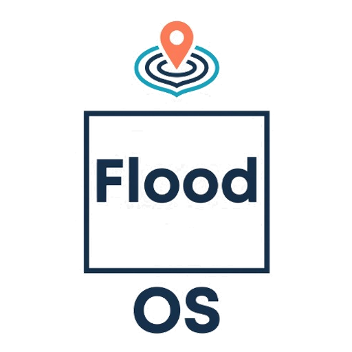
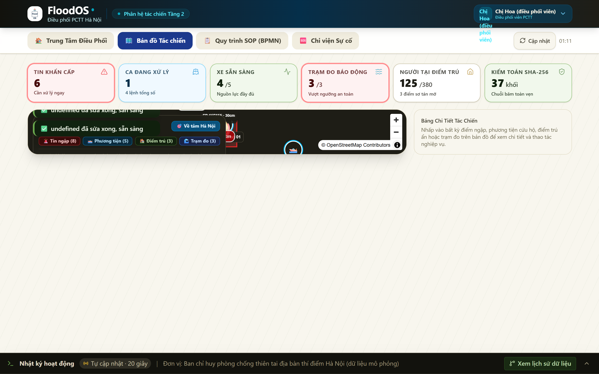
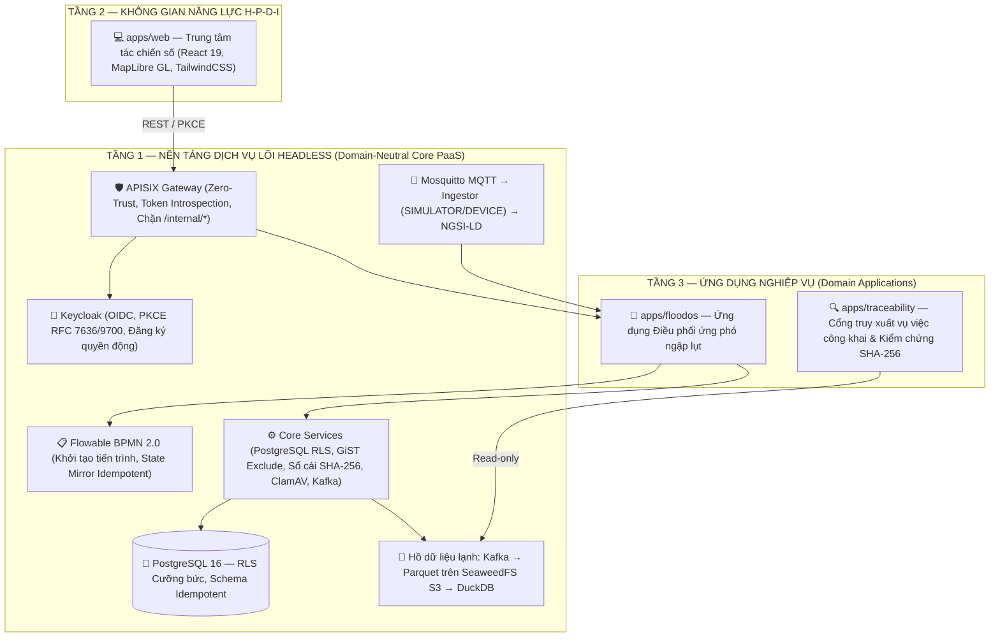
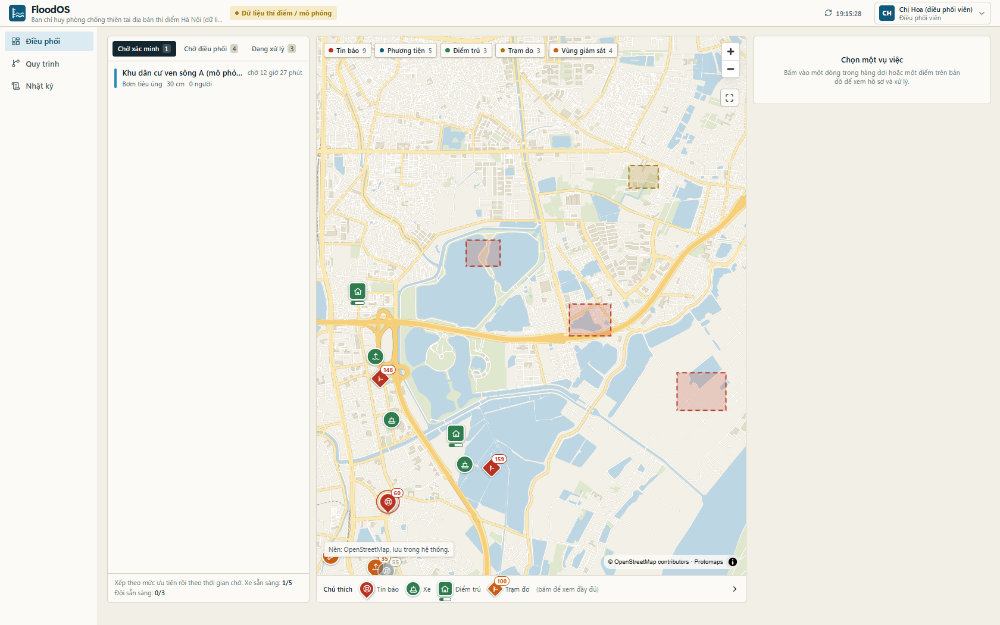
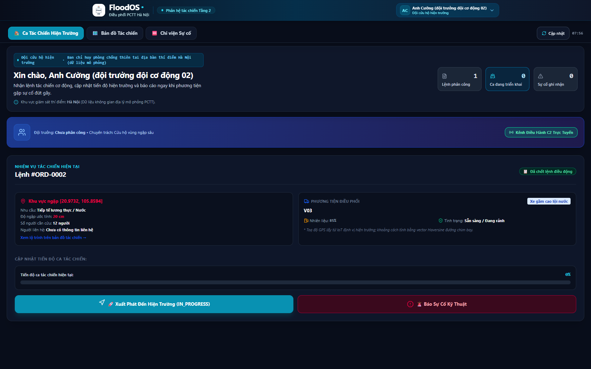
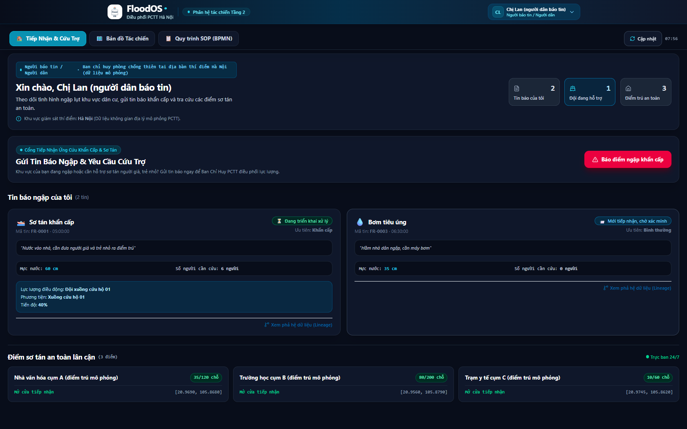
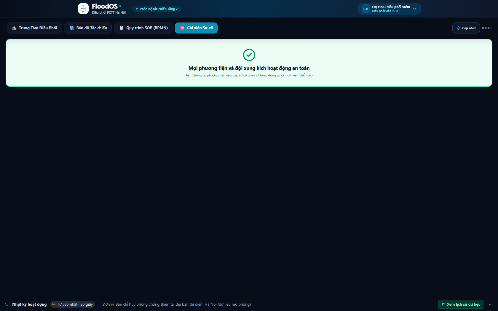
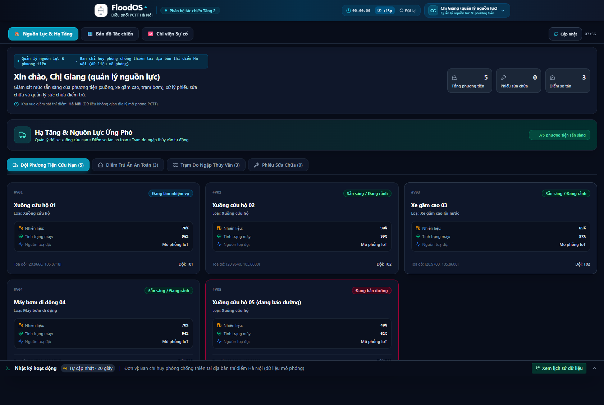
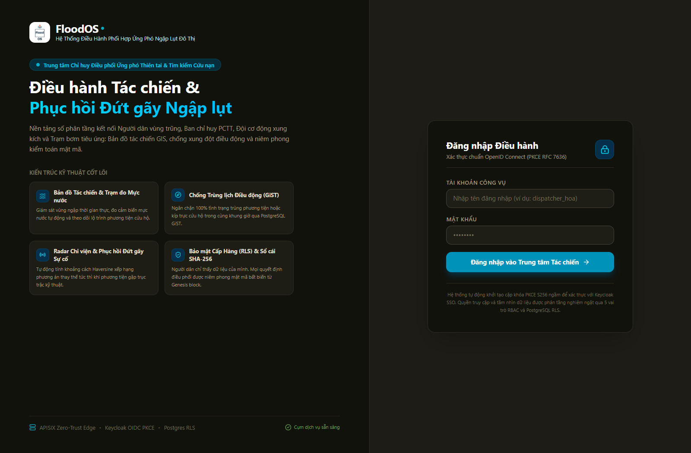

<div align="center">

<a href="https://github.com/Floodos-hou/FloodOS">
  
</a>

# FloodOS

### Hệ điều hành Chuyển đổi số mã nguồn mở (DX-OS Open-Core) điều phối ứng phó ngập lụt đô thị
*An Open-Core Digital Transformation Operating System for Urban Flood Response Coordination*

[](LICENSE)
[](pom.xml)
[](docs/architecture.md)
[](core/data-services/NgsiLdTwinMapper.java)
[](infra/gateway/apisix.yaml)
[](https://github.com/Floodos-hou/FloodOS/releases)

---

**Bài dự thi OLP 2026 — Khối Phần mềm nguồn mở**  
*Chủ đề: Xây dựng Hệ điều hành Chuyển đổi số bằng Công nghệ Lõi nguồn mở (DX-OS Open-Core)*  
**Địa bàn thí điểm:** Hà Nội | **Mã nguồn:** 100% Nguồn mở theo chuẩn Apache-2.0

[Tổng quan](#-1-floodos-là-ứng-dụng-gì-và-giúp-người-dùng-việc-gì) •
[Kiến trúc 3 tầng](#-kiến-trúc-hệ-thống-dx-os-open-core) •
[Giao diện tác chiến](#️-trung-tâm-chỉ-huy-tác-chiến-không-gian-năng-lực-tầng-2) •
[Phân quyền 5 vai trò](#-bảng-phân-quyền-tác-chiến-5-vai-trò) •
[Minh bạch dữ liệu](#-bản-đồ-trạng-thái-minh-bạch-honesty-matrix) •
[Cài đặt nhanh](#-khởi-chạy-nhanh-trong-3-phút) •
[Kiểm thử](#-kiểm-thử-toàn-diện)

</div>

<br>

<p align="center">
  
</p>


---

## 🎯 1. FloodOS là ứng dụng gì và giúp người dùng việc gì?

**FloodOS** là ứng dụng điều hành phối hợp ứng phó ngập lụt cho một địa bàn thí điểm tại Hà Nội. Ứng dụng kết nối người báo tin, người điều phối, đội hiện trường và người quản lý nguồn lực trong cùng một hồ sơ vụ việc.

### Vấn đề ứng dụng giải quyết
Khi nhiều điểm ngập phát sinh cùng lúc, thông tin cứu trợ thường đến qua điện thoại hoặc tin nhắn rời rạc; người điều phối rất khó biết tin nào khẩn cấp, đội hoặc phương tiện nào đang rảnh, điểm trú nào còn chỗ và một lệnh ứng cứu đã được xử lý tới đâu. Việc điều phối lại khi xe/xuồng/máy bơm gặp sự cố kỹ thuật giữa đường cũng dễ bị chậm trễ hoặc mất dấu vết quyết định.

### FloodOS giúp từng nhóm người dùng:
- **Người dân / Người báo tin (`REPORTER`):** Báo vị trí, mức ngập, số người bị ảnh hưởng và nhu cầu hỗ trợ khẩn cấp; theo dõi tiến trình xử lý tin báo của mình, biết tin đang được xác minh hay đã có lực lượng tiếp cận hiện trường.
- **Điều phối viên (`DISPATCHER`):** Xem toàn cảnh bức tranh các vụ việc trên bản đồ số và dòng thời gian (timeline); xác minh thông tin, gán mức ưu tiên; phân công đội và phương tiện; phát hiện ngay xung đột lịch trình; chủ động điều phối lại khi xảy ra sự cố.
- **Đội hiện trường (`FIELD_TEAM`):** Nhận đúng nhiệm vụ được phân công trên thiết bị di động, nắm rõ tọa độ điểm đến và nhu cầu cụ thể tại hiện trường, cập nhật tiến độ xử lý hoặc báo cáo sự cố nhanh chóng chỉ bằng vài thao tác.
- **Quản lý nguồn lực (`RESOURCE_MANAGER`):** Theo dõi mức độ sẵn sàng của phương tiện (xuồng, xe bơm) và các đội ứng cứu, tình trạng sức chứa tại các điểm trú an toàn; xử lý và đóng phiếu sửa chữa kỹ thuật trong đúng phạm vi quyền hạn.
- **Người có quyền kiểm tra / Thanh tra (`AUDITOR` / `PUBLIC`):** Xem lại toàn bộ lịch sử ra quyết định và kiểm chứng chuỗi băm kiểm toán bất biến SHA-256 của từng vụ việc độc lập với cơ sở dữ liệu.

> **Thông điệp cốt lõi:** *“Các ứng dụng cứu trợ hiện nay chủ yếu cho thấy ai đang cầu cứu; FloodOS tiến xa hơn: cho biết nên cử ai đến, vì sao lại chọn họ, và chứng minh được tính minh bạch của quyết định đó bằng chuỗi kiểm toán mật mã.”*
>
> **Giá trị tác chiến:** Đưa một vụ việc từ lúc tiếp nhận tin báo đến khi xác nhận hoàn tất qua một quy trình khép kín có người chịu trách nhiệm, có nguồn lực được phân công tối ưu (khoảng cách chim bay, sức chứa, kinh nghiệm đội), có trạng thái cập nhật thời gian thực và có sổ cái kiểm toán bất biến SHA-256. Giao diện luôn trả lời rõ ràng: *“Đang xảy ra việc gì, ở đâu, ai đang xử lý và bước tiếp theo là gì?”*

---

## 2. Kịch bản tiêu biểu 7 bước trình diễn (End-to-End Live Scenario)

Kịch bản sử dụng một tình huống xuyên suốt, vận hành hoàn toàn bằng API backend thật và đăng nhập đúng vai trò:

| Bước | Vai trò & Tài khoản | Thao tác thực tế trên giao diện | Kết quả hiển thị trên hệ thống |
|:---:|---|---|---|
| **1** | **Người dân**<br/>`reporter_lan` | Người dân gửi tin báo điểm ngập tại Hà Nội: nước ngập sâu 60 cm, 5 người cần sơ tán, gửi kèm ảnh hiện trường. | Tin báo `FR-...` xuất hiện ngay trên bản đồ tác chiến và danh sách, trạng thái: *Tiếp nhận, chờ xác minh*. |
| **2** | **Điều phối viên**<br/>`dispatcher_hoa` | Mở danh sách tin mới, xem vị trí trên bản đồ, xác minh tin và đặt mức ưu tiên `URGENT`. | Tin chuyển sang *Đã xác minh*. Quy trình BPMN SOP-01 chuyển bước, sẵn sàng phân công lực lượng. |
| **3** | **Điều phối viên**<br/>`dispatcher_hoa` | Chọn điều động **Xuồng cứu hộ V02 + Đội cơ động T02**. *(Có thể demo thử chọn khung giờ trùng để thấy hệ thống chặn 409 GiST Conflict)*. | Lệnh điều động `ORD-...` được ban hành. Phương tiện V02 chuyển trạng thái sang sẵn sàng xuất phát. |
| **4** | **Đội hiện trường**<br/>`team_cuong` | Đăng nhập trên điện thoại, nhận lệnh, bấm **Bắt đầu xử lý** (`IN_PROGRESS`). Khi gặp sự cố chân vịt vướng rác ngập, bấm **Báo sự cố**. | Xuồng V02 đổi màu đỏ nhấp nháy (`BREAKDOWN`). Ca điều động gián đoạn, kích hoạt quy trình điều phối lại SOP-02. |
| **5** | **Điều phối viên**<br/>`dispatcher_hoa` | Vào tab **Sự cố & Chi viện**, xem danh sách phương án thay thế được chấm điểm minh bạch (khoảng cách Haversine, loại xe, công suất, đánh giá đội). | Bảng phân tích giải thích rõ lý do xếp hạng. Điều phối viên bấm **Phê duyệt chi viện** chọn Xuồng V01 + Đội T01. |
| **6** | **Đội chi viện**<br/>`team_binh` | Đội trưởng V01 tiếp nhận lệnh mới `-R1`, di chuyển tiếp cận mục tiêu, cập nhật tiến độ 100% và bấm **Hoàn tất nhiệm vụ**. | Vụ việc chuyển sang trạng thái hoàn tất cứu hộ, chờ người báo tin nghiệm thu an toàn. |
| **7** | **Người dân & Thanh tra**<br/>`reporter_lan` | Người dân bấm **Xác nhận đã an toàn**. Mở **Proof Inspector** hoặc cổng công khai Tầng 3 tra cứu chuỗi phả hệ SHA-256. | Toàn bộ chuỗi sự kiện được niêm phong mật mã bất biến, xác minh tính toàn vẹn liên tục từ Genesis block. |

> **Cam kết tính trung thực của kịch bản:** Kịch bản cho thấy FloodOS hỗ trợ điều phối và theo dõi; **không** thể hiện như phần mềm dự báo ngập lụt khí tượng, hệ thống cảnh báo cảm biến thật, AI tự động ra quyết định, hay hệ thống dẫn đường giao thông vì các năng lực đó chưa có và chưa được kiểm chứng.

---

## 3. Nguyên tắc thiết kế giao diện theo mục đích sử dụng

- **Bản đồ tình huống + Dòng thời gian + Hành động tiếp theo:** Ưu tiên hiển thị trực quan không gian tác chiến, tuyệt đối không biến giao diện thành bảng quản trị CRUD có các nút thêm/sửa/xóa khô khan.
- **Ngữ cảnh tác chiến tức thời:** Mỗi màn hình phải trả lời ngay: Người dùng đang xem vụ việc nào, trạng thái hiện tại là gì, nguồn dữ liệu và thời điểm cập nhật ra sao, họ có quyền thực hiện bước nào tiếp theo.
- **Trực quan hóa bản đồ 2D/3D:** Bản đồ làm rõ vị trí và tương quan nguồn lực; mọi điểm đánh dấu (marker), trạng thái và chuyển động đều bắt nguồn từ dữ liệu API thật hoặc simulator có gắn nhãn nguồn minh bạch.
- **Minh bạch nhãn nguồn dữ liệu:** Mọi dữ liệu mô phỏng (`SIMULATOR`, `SEED`) được đánh dấu rõ ràng. Tuyệt đối không tạo số liệu, địa danh, trạng thái xe chạy ảo chỉ để làm màn hình sinh động.
- **Thiết kế hướng tới Demo thật:** Người trình diễn có thể đăng nhập đúng từng vai trò (OIDC PKCE Keycloak) và thao tác tuần tự qua toàn bộ luồng nghiệp vụ trên bằng các lệnh gọi API backend thật.

---

---

## 🏛️ Kiến trúc hệ thống: DX-OS Open-Core

FloodOS tuân thủ tuyệt đối quy tắc **tách biệt ranh giới** theo đề thi OLP 2026: Lõi nền tảng PaaS không chứa bất kỳ thuật ngữ hay bảng dữ liệu nào của nghiệp vụ ngập lụt.




### 🔬 Hiện thực hóa 4 nguyên lý kỹ thuật cốt lõi

| Nguyên lý kỹ thuật | Hiện thực cụ thể trong mã nguồn FloodOS |
|---|---|
| **(i) Tách luồng nóng/lạnh** | Dữ liệu giao dịch nóng đi vào PostgreSQL 16; sự kiện kiểm toán và telemetry phát bất đồng bộ lên **Apache Kafka** → **lake-archiver** gom lô nén định dạng **Parquet** trên **SeaweedFS S3** → **DuckDB** truy vấn phân tích tức thì. |
| **(ii) Hội tụ IT và OT (Bản sao số)** | Cảm biến/thiết bị phát MQTT qua **Eclipse Mosquitto** (ACL tối thiểu) → **ingestor** kiểm tra chữ ký & nhãn nguồn (`SIMULATOR` hoặc `DEVICE`) → chuyển đổi sang chuẩn **ETSI NGSI-LD** (`RescueVehicle`, `WaterGaugeStation`). |
| **(iii) Phả hệ & Chất lượng dữ liệu** | Sổ cái băm SHA-256 bất biến (`audit_records`), API `/audit/lineage/{id}`; ứng dụng Tầng 3 độc lập tự tính lại chuỗi băm từ kho Parquet. Mọi bản ghi đều gắn thẻ nguồn gốc dữ liệu (`SEED`, `SIMULATOR`, `REPORTED`, `DEVICE`). |
| **(iv) Zero-Trust & Hạ tầng bằng mã** | Cổng **Apache APISIX** xác thực token tại biên qua Keycloak; cơ sở dữ liệu bật `FORCE ROW LEVEL SECURITY`; quét mã độc **ClamAV** chế độ fail-closed (từ chối tệp nếu dịch vụ quét tắt); toàn bộ hệ thống triển khai bằng Docker Compose v2. |

---

## 🖥️ Trung tâm chỉ huy tác chiến (Không gian năng lực Tầng 2)

Trung tâm tác chiến số tại [`apps/web`](apps/web) được xây dựng trên nền tảng **React 19**, **TypeScript**, **TailwindCSS** và **MapLibre GL**, kết nối 100% với API backend thật qua APISIX Zero-Trust Gateway:

### 🗺️ 1. Bản đồ tác chiến số thời gian thực (Tactical Command Map)
- **Không gian địa lý Hà Nội:** Tích hợp bản đồ nền số MapLibre GL trực quan, định vị chính xác các khu vực ngập úng, điểm tin báo khẩn cấp, trạm đo mực nước thủy văn và các điểm sơ tán an toàn.
- **Giám sát phương tiện di động:** Hiển thị vị trí, hướng di chuyển và trạng thái (`IDLE`, `EN_ROUTE`, `RESCUING`, `BREAKDOWN`) của xuồng cứu hộ và xe bơm lưu động qua kênh truyền thông IoT/MQTT Mosquitto.
- **Lớp dữ liệu bản đồ:** Cho phép bật/tắt linh hoạt các lớp (Tin ngập, Phương tiện, Điểm trú, Trạm đo) kèm tính năng định vị nhanh về tâm bản đồ tác chiến.

<p align="center">
  
</p>

### 📋 2. Trung tâm điều phối PCTT (Dispatcher Command Center)
- **Tiếp nhận & Thẩm định:** Điều phối viên kiểm tra tin báo mới từ người dân, xem vị trí trên bản đồ, xác minh tin (`VERIFIED` / `REJECTED`) và gán mức ưu tiên (`CRITICAL`, `URGENT`, `NORMAL`).
- **Điều động & Chặn trùng lịch 409 GiST:** Phân công đội cứu hộ và phương tiện (xuồng/xe bơm). Cơ chế RLS và ràng buộc loại trừ GiST ở database tự động phát hiện và chặn các xung đột lịch trình.

<p align="center">
  
</p>

### 🧑‍🚒 3. Ca tác chiến cơ động của Đội cứu hộ (Field Team Cockpit)
- **Tác nghiệp di động:** Đội trưởng nhận lệnh điều động trực tiếp trên điện thoại di động, cập nhật tiến độ theo từng mốc (`IN_PROGRESS`), nắm rõ tọa độ và số người cần cứu hộ.
- **Báo sự cố khẩn cấp & Bàn giao:** Khi gặp sự cố kỹ thuật (chân vịt vướng rác, chết máy), bấm báo sự cố để chuyển giao thức SOP-02; khi cứu hộ xong, nhập biên bản kết quả và bấm hoàn tất (`COMPLETED`).

<p align="center">
  
</p>

### 🙋‍♀️ 4. Cổng tiếp nhận cứu trợ & Nghiệm thu Người dân (Citizen Reporting Portal)
- **Gửi tin báo ngập:** Người dân gửi tọa độ GPS, mức nước ngập (cm), số người bị mắc kẹt, nhu cầu cứu hộ và ảnh chụp hiện trường (tự động quét ClamAV).
- **Theo dõi & Nghiệm thu an toàn:** Người dân theo dõi tiến độ xử lý tin của mình (chỉ thấy tin của chính mình nhờ PostgreSQL RLS). Khi đội hoàn thành, người dân bấm **Xác nhận đã an toàn** để chính thức đóng hồ sơ vụ việc.

<p align="center">
  
</p>

### ⚡ 5. Radar chi viện & Phục hồi đứt gãy sự cố (SOP-02 Replan Radar)
- **Xếp hạng cứu hộ đa tiêu chí:** Khi phương tiện gặp sự cố giữa dòng, động cơ xếp hạng tự động tính điểm các phương án thay thế khả dụng theo 4 tiêu chí minh bạch có giải thích rõ ràng: *Khoảng cách Haversine (40đ) + Loại phương tiện (25đ) + Sức chứa/Công suất (20đ) + Đánh giá đội (15đ)*.
- **Phê duyệt tái điều phối:** Điều phối viên chủ động kiểm tra lý do và bấm duyệt; lệnh cũ chuyển `SUPERSEDED`, lệnh mới `-R1` kế thừa mã vụ việc, bảo đảm tính liên tục của nhiệm vụ.

<p align="center">
  
</p>

### 🛠️ 6. Quản lý nguồn lực & Hạ tầng điểm sơ tán (Resource Manager Workspace)
- **Theo dõi phương tiện & Trạm đo:** Giám sát mức nhiên liệu, tình trạng máy, tọa độ thực tế của xuồng và xe lội nước; cảnh báo mực nước tự động tại các trạm đo ngập thủy văn.
- **Quản lý sức chứa điểm trú ẩn:** Cập nhật số người sơ tán tại các nhà văn hóa, trường học, điểm cao ráo; xử lý và nghiệm thu phiếu sửa chữa kỹ thuật (`repair-ticket`).

<p align="center">
  
</p>

### 🔐 7. Cổng xác thực công vụ tập trung & Kiểm chứng mật mã (Unified Login & Proof Inspector)
- **Đăng nhập điều hành OIDC PKCE:** Form đăng nhập công vụ đồng bộ, bảo vệ theo chuẩn RFC 7636 PKCE S256 ngầm qua Keycloak OIDC, không lộ cơ chế demo, tuyệt đối không dùng 2 cổng đăng nhập trùng lặp.
- **Trình kiểm chứng chuỗi băm:** Tích hợp cửa sổ kiểm chứng chuỗi băm SHA-256 trực quan ngay trên giao diện: đối soát phả hệ dữ liệu (`lineage`) và chứng minh tính toàn vẹn của chuỗi sự kiện nối liền từ Genesis block.

<p align="center">
  
</p>

---

## 👥 Bảng phân quyền tác chiến (5 vai trò)

FloodOS triển khai cơ chế kiểm soát truy cập dựa trên vai trò (RBAC) kết hợp bảo vệ dữ liệu theo hàng (PostgreSQL RLS) ở cả lớp ứng dụng và cơ sở dữ liệu:

| Vai trò | Người dùng đại diện | Thẩm quyền tác chiến | Phạm vi dữ liệu nhìn thấy |
|---|---|---|---|
| `REPORTER`<br/>*(Người báo tin)* | `reporter_lan`<br/>`reporter_hung` | • Gửi tin báo ngập lụt kèm tọa độ & ảnh chụp hiện trường<br/>• Xác nhận (`CONFIRMED`) hoặc phản đối (`DISPUTED`) kết quả cứu hộ | Chỉ thấy duy nhất tin báo của chính mình, điểm trú ẩn, trạm đo và lệnh/phương tiện đang phục vụ mình. **Tuyệt đối không thấy tin báo người khác.** |
| `DISPATCHER`<br/>*(Điều phối viên)* | `dispatcher_hoa` | • Thẩm định, xác minh hoặc từ chối tin báo<br/>• Gán mức ưu tiên (`CRITICAL`, `URGENT`, `NORMAL`)<br/>• Điều động đội cứu hộ & xuồng/xe (kiểm tra xung đột)<br/>• Phê duyệt phương án thay thế khi xảy ra sự cố | Toàn bộ dữ liệu tác chiến thuộc đơn vị quản lý (`organization_id`). |
| `FIELD_TEAM`<br/>*(Đội hiện trường)* | `team_binh`<br/>`team_cuong`<br/>`team_dung` | • Tiếp nhận lệnh điều động trên di động<br/>• Cập nhật tiến độ (`IN_PROGRESS`, `COMPLETED`)<br/>• Báo cáo sự cố phương tiện hỏng hóc giữa đường | Chỉ thấy thông tin đội của mình, lệnh được giao, phương tiện đang điều khiển và tin báo tương ứng. |
| `RESOURCE_MANAGER`<br/>*(Quản lý nguồn lực)* | `resource_giang` | • Cập nhật trạng thái bảo dưỡng đội và phương tiện<br/>• Mở và đóng phiếu sửa chữa kỹ thuật (`repair-ticket`) | Đội cứu hộ, phương tiện, phiếu sửa chữa. **Không được duyệt điều động tác chiến.** |
| `PLATFORM_ADMIN`<br/>*(Quản trị nền tảng)* | `platform_admin` | • Giám sát trạng thái hoạt động hạ tầng<br/>• Đặt lại dữ liệu mô phỏng demo (chỉ mở ở môi trường test) | Phạm vi kỹ thuật nền tảng; **không có quyền can thiệp dữ liệu nghiệp vụ**. |

> **Quy tắc bảo mật Zero-Trust:** Khi người dùng truy cập bản ghi nằm ngoài phạm vi được phân quyền, hệ thống trả về mã lỗi **404 Not Found** (không làm lộ sự tồn tại của bản ghi) và tự động ghi sự kiện `RBAC_BLOCKED_*` vào sổ cái kiểm toán bất biến.

---

## 📋 Bản đồ trạng thái minh bạch (Honesty Matrix)

Để đảm bảo tính trung thực tuyệt đối theo tiêu chuẩn phần mềm nguồn mở OLP 2026, các hạng mục tính năng được phân định rõ ràng:

| Hạng mục chức năng | Trạng thái | Minh chứng kỹ thuật trong mã nguồn |
|---|:---:|---|
| **Đăng nhập một lần OIDC + PKCE** | ✅ **CÓ THẬT** | Keycloak 24 thật; kiểm thử E2E tự động qua APISIX; chặn `code_verifier` giả mạo. |
| **Cổng API Gateway Zero-Trust** | ✅ **CÓ THẬT** | Apache APISIX 3.9; introspection token tại biên; chặn tuyệt đối `/api/v1/internal/*`. |
| **Phân quyền 5 vai trò & PostgreSQL RLS** | ✅ **CÓ THẬT** | Bật `FORCE ROW LEVEL SECURITY`, tài khoản app không có quyền superuser; kiểm thử cô lập từng vai trò. |
| **Chống xếp trùng lịch tài nguyên** | ✅ **CÓ THẬT** | Ràng buộc loại trừ GiST ở PostgreSQL + kiểm tra logic tại lõi Java (trả mã `409 Conflict`). |
| **Quét mã độc tải lên (Malware Gate)** | ✅ **CÓ THẬT** | ClamAV quét INSTREAM; từ chối chuỗi thử nghiệm EICAR (mã 422); chế độ fail-closed khi ClamAV tắt (mã 503). |
| **Quy trình nghiệp vụ chuẩn BPMN 2.0** | ⚠️ **MỘT PHẦN** | Triển khai BPMN lên Flowable 7 thật; quản lý bản sao trạng thái Idempotent. Chưa gọi REST để complete task ngoài Flowable. |
| **Sổ cái kiểm toán SHA-256 & Phả hệ dữ liệu** | ✅ **CÓ THẬT** | Bảng `audit_records` xâu chuỗi băm; Tầng 3 (`apps/traceability`) tự tính lại độc lập từ Parquet. |
| **Xếp hạng phương án cứu hộ cứu nạn** | ✅ **CÓ THẬT** | Thuật toán chấm điểm theo 4 tiêu chí có giải thích rõ ràng tại [`RescueScoring.java`](apps/floodos/RescueScoring.java). **Không dùng AI giả mạo.** |
| **Giao diện tác chiến trực quan & Demo flow** | ✅ **CÓ THẬT** | `apps/web` (React 19, MapLibre GL) kết nối 100% backend thật qua APISIX Gateway. |
| **Dữ liệu tọa độ phương tiện & Trạm đo** | 🟡 **MÔ PHỎNG** | Bộ sinh giả lập phát qua MQTT (`source=SIMULATOR`). Tọa độ phương tiện chạy đường thẳng; mực nước sinh ngẫu nhiên có chặn. |
| **Bản đồ địa hình & Mạng lưới giao thông** | ⚠️ **CHƯA CÓ** | Khoảng cách tính theo công thức Haversine (đường chim bay); chưa tích hợp mạng lưới định tuyến giao thông tránh ngập. |
| **Dữ liệu khí tượng thủy văn chính thức** | ⚠️ **CHƯA CÓ** | Sử dụng dữ liệu hạt giống (`SEED`) minh họa trên địa bàn Hà Nội; không sử dụng dữ liệu quan trắc thật khi chưa được cấp phép. |

---

## ⚡ Khởi chạy nhanh trong 3 phút

### Yêu cầu môi trường
- **Hệ điều hành:** Linux, macOS, hoặc Windows (WSL2)
- **Docker Engine:** Phiên bản 24.0+ & Docker Compose v2
- **Cấu hình tối thiểu:** 4 Cores CPU, 6GB RAM khả dụng

### 1. Dựng toàn bộ hệ thống bằng Docker Compose

```bash
# Clone mã nguồn
git clone https://github.com/Floodos-hou/FloodOS.git
cd FloodOS

# Khởi động toàn bộ stack dịch vụ kèm bộ mô phỏng dữ liệu OT
docker compose --profile demo up -d --build

# Kiểm tra trạng thái sức khỏe qua API Gateway
curl -i http://localhost:9080/api/v1/health
```

### 2. Truy cập các cổng giao diện

| Giao diện / Dịch vụ | Địa chỉ URL | Ghi chú |
|---|---|---|
| **Trung tâm tác chiến FloodOS** | `http://localhost:9080` (hoặc `http://localhost:3000`) | Cổng web chính thức qua APISIX Zero-Trust Gateway (`5173` khi chạy Vite dev) |
| **Cổng truy xuất công khai Tầng 3** | `http://localhost:9080/trace/CORR-REP-001` | Cổng tra cứu phả hệ & kiểm chứng SHA-256 |
| **Keycloak Identity Console** | `http://localhost:8080` | Quản trị định danh & realm `floodos` |
| **APISIX Gateway Dashboard** | `http://localhost:9080` | Cổng Zero-Trust Gateway quản trị định tuyến |

### 3. Danh sách tài khoản demo (Mật khẩu mặc định: `123456`)

- 🏠 **Người báo tin:** `reporter_lan` hoặc `reporter_hung`
- 📋 **Điều phối viên:** `dispatcher_hoa`
- 🚨 **Đội hiện trường:** `team_binh` (Xuồng V01), `team_cuong` (Xuồng V02), `team_dung` (Xe bơm V03)
- 🔧 **Quản lý nguồn lực:** `resource_giang`
- ⚙️ **Quản trị nền tảng:** `platform_admin`

---

## 🧪 Kiểm thử toàn diện

Hệ thống được trang bị bộ kiểm thử đa tầng nghiêm ngặt nhằm đảm bảo tính ổn định và bảo mật:

```bash
# 1. Chạy toàn bộ Unit Tests (Java + Python + TypeScript)
bash tests/run_unit_tests.sh

# 2. Chạy Acceptance Tests trong tiến trình (HTTP thật, luồng nghiệp vụ đầy đủ)
java -cp target/classes org.floodos.tests.AcceptanceTestRunner

# 3. Chạy kiểm thử tích hợp E2E toàn stack trên Docker thật
bash tests/e2e_full_stack_test.sh
```

### 📊 Thống kê phạm vi kiểm thử (Test Coverage)

```
========================================================================
  FLOODOS MULTI-LAYER AUTOMATED VERIFICATION MATRIX
========================================================================
  [Java Core & Apps Unit Tests]     : 191/191 PASS  (100%)
  [Acceptance Golden Path Tests]    :  50/50  PASS  (100%)
  [Python Lake & Telemetry Tests]   : 114/114 PASS  (100%)
  [Web Tactical Frontend Tests]     :  33/33  PASS  (100%)
  [Full-Stack Container Assertions] :  12/12  PASS  (100%)
========================================================================
  TOTAL AUTOMATED TEST COVERAGE     : 400/400 PASS  (100%)
========================================================================
```

---

## 🛠️ Công nghệ sử dụng và Giấy phép

| Thành phần | Công nghệ / Phiên bản | Vai trò trong kiến trúc | Giấy phép |
|---|---|---|---|
| **Lõi nền tảng (Core)** | Java 21 LTS (Temurin) | Xử lý logic phi miền, điều vận giao dịch, sổ cái băm | GPL-2.0 w/ CE |
| **Cổng API Zero-Trust** | Apache APISIX 3.9.0 | Định tuyến biên, xác thực OIDC token tại chỗ | Apache-2.0 |
| **Quản trị định danh** | Keycloak 24.0.5 | Chuẩn xác thực OIDC, PKCE RFC 7636/9700 | Apache-2.0 |
| **Cơ sở dữ liệu** | PostgreSQL 16.2 | Ràng buộc loại trừ GiST, Row-Level Security cưỡng bức | PostgreSQL License |
| **Quy trình nghiệp vụ** | Flowable BPMN 7.0.0 | Động cơ điều phối tiến trình theo chuẩn BPMN 2.0 | Apache-2.0 |
| **Lưu trữ đối tượng** | SeaweedFS 3.64 | Kho lưu trữ S3 lưu ảnh hiện trường và kho dữ liệu Parquet | Apache-2.0 |
| **Hàng đợi thông điệp** | Apache Kafka 3.7.1 & Karapace | Truyền phát sự kiện kiểm toán và telemetry OT | Apache-2.0 |
| **Thu nhận dữ liệu IoT** | Eclipse Mosquitto 2.0.18 | Broker MQTT xác thực và phân quyền theo topic | EPL-2.0 / EDL-1.0 |
| **Phân tích kho lạnh** | DuckDB & Apache Parquet | Động cơ OLAP truy vấn hồ dữ liệu lạnh tốc độ cao | MIT |
| **Cổng quét mã độc** | ClamAV 1.4.3 | Quét virus tệp tải lên fail-closed ở chế độ INSTREAM | GPL-2.0 |
| **Giao diện tác chiến** | React 19, TypeScript, MapLibre GL | Trung tâm chỉ huy trực quan hóa thời gian thực | MIT / BSD |

---

## 📚 Tài liệu kỹ thuật chi tiết

- 📐 **Kiến trúc hệ thống:** [`docs/architecture.md`](docs/architecture.md)
- 🔌 **Đặc tả giao diện API:** [`docs/api-spec.md`](docs/api-spec.md)
- 🛡️ **Mô hình an ninh & Zero-Trust:** [`docs/security.md`](docs/security.md)
- 🎮 **Kịch bản Demo chi tiết:** [`docs/demo-guide.md`](docs/demo-guide.md)
- 📱 **Định hướng trải nghiệm người dùng (UX):** [`docs/floodos-demo-ux.md`](docs/floodos-demo-ux.md)
- 📜 **Lịch sử phiên bản:** [`CHANGELOG.md`](CHANGELOG.md)

---

## 🤝 Đóng góp và Phát triển

Mọi đóng góp cho dự án đều được chào đón! Vui lòng đọc kĩ [`CONTRIBUTING.md`](CONTRIBUTING.md) và tuân thủ các quy tắc kỹ thuật nghiêm ngặt tại [`AGENTS.md`](AGENTS.md).

Mã nguồn dự án được phát hành theo giấy phép **Apache License 2.0** — xem chi tiết tại tệp [`LICENSE`](LICENSE).

<div align="center">
<sub>Được phát triển với tinh thần cống hiến cho cộng đồng và cuộc thi Olympic Tin học Sinh viên Việt Nam (OLP 2026).</sub>
</div>
