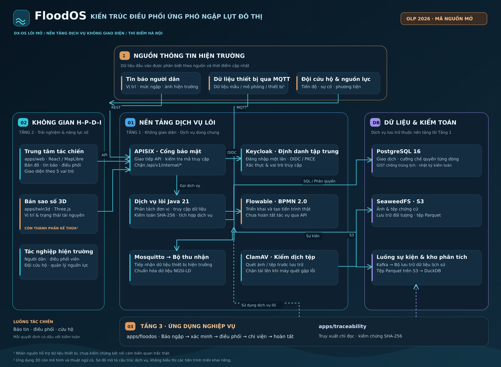
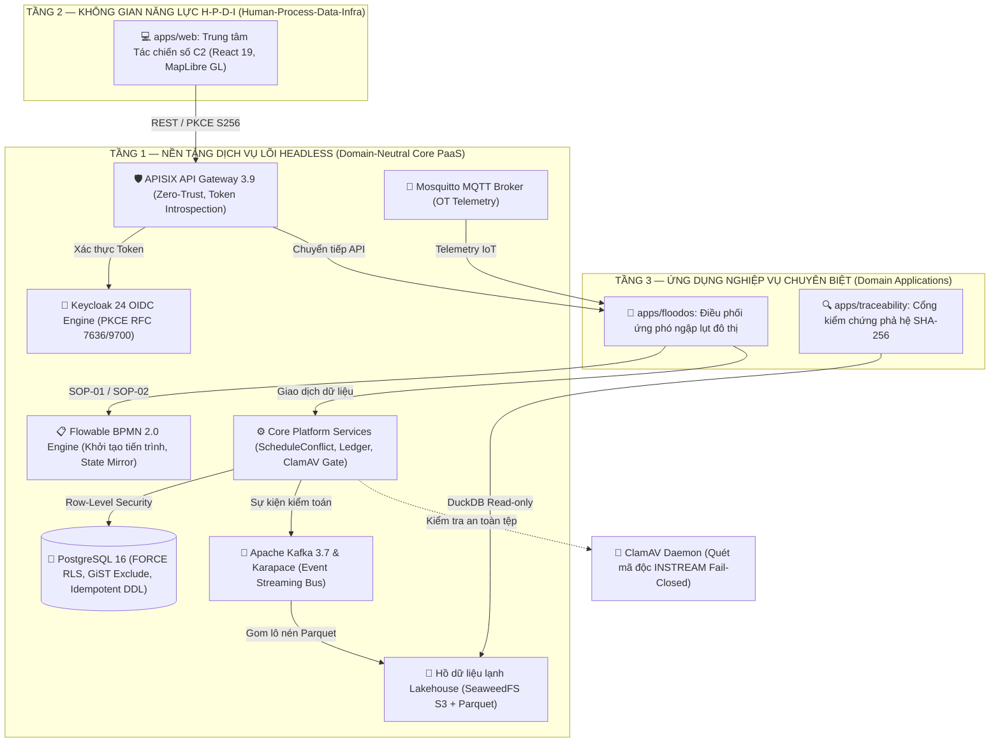
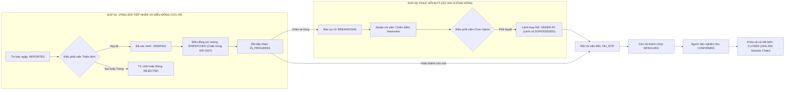
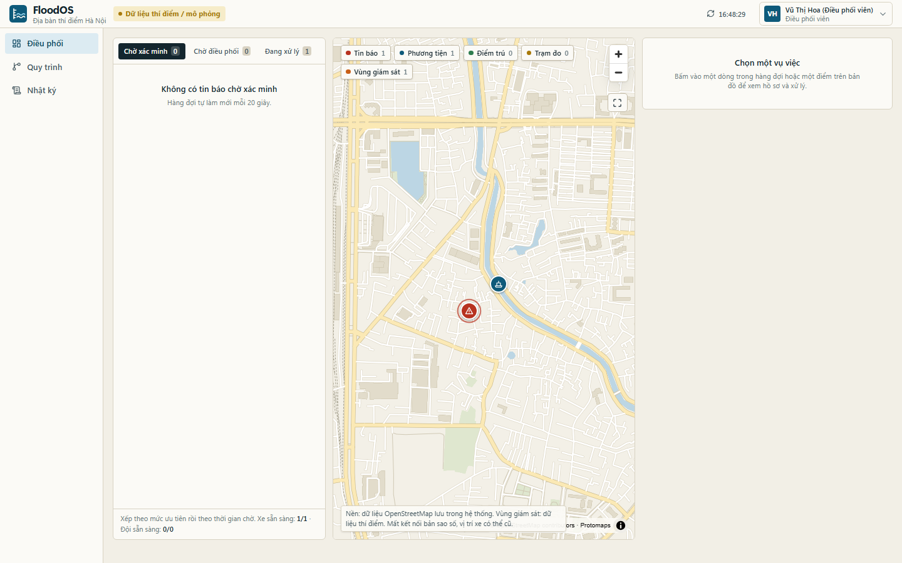
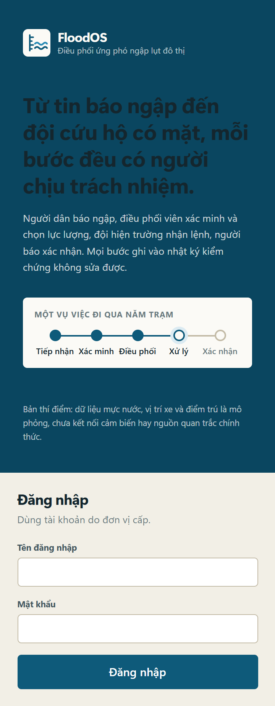
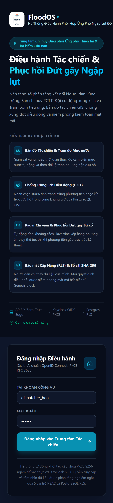

<div align="center">

<a href="https://github.com/Floodos-hou/FloodOS">
  
</a>

# FloodOS

### Hệ điều hành Chuyển đổi số mã nguồn mở (DX-OS Open-Core) điều phối ứng phó ngập lụt đô thị
*An Open-Core Digital Transformation Operating System for Urban Flood Response Coordination*

<br>

[](LICENSE)
[](docs/releases/v0.2.0.md)
[](pom.xml)
[](apps/web)
[](infra/gateway/apisix.yaml)
[-success.svg?style=for-the-badge)](tests/run_unit_tests.sh)
[](core/data-services/NgsiLdTwinMapper.java)

---

**Bài dự thi OLP 2026 — Khối Phần mềm nguồn mở**  
*Chủ đề: Xây dựng Hệ điều hành Chuyển đổi số bằng Công nghệ Lõi nguồn mở (DX-OS Open-Core)*  
**Địa bàn thí điểm:** TP. Hà Nội | **Bản quyền:** 100% Nguồn mở theo chuẩn **Apache-2.0**

[🎯 Tổng quan](#-1-floodos-là-ứng-dụng-gì-và-giúp-người-dùng-việc-gì) •
[🏛️ Kiến trúc 3 tầng](#️-kiến-trúc-hệ-thống-dx-os-open-core) •
[🔄 Quy trình tác chiến](#-quy-trình-nghiệp-vụ-chuẩn-sop-01--sop-02) •
[🖥️ Giao diện tác chiến](#️-trung-tâm-chỉ-huy-tác-chiến-không-gian-năng-lực-tầng-2) •
[👥 Phân quyền 5 vai trò](#-bảng-phân-quyền-tác-chiến-5-vai-trò) •
[📋 Minh bạch dữ liệu](#-bản-đồ-trạng-thái-minh-bạch-honesty-matrix) •
[⚡ Khởi chạy nhanh](#-khởi-chạy-nhanh-trong-3-phút) •
[🧪 Kiểm thử](#-kiểm-thử-toàn-diện)

</div>

<br>

<p align="center">
  
</p>

---

## 🎯 1. FloodOS là ứng dụng gì và giúp người dùng việc gì?

**FloodOS** là hệ điều hành chuyển đổi số mã nguồn mở điều phối ứng phó ngập lụt đô thị cho địa bàn thí điểm tại Hà Nội. Ứng dụng kết nối thông suốt người báo tin, người điều phối, đội cơ động hiện trường và người quản lý nguồn lực trong cùng một hồ sơ vụ việc số duy nhất.

### Vấn đề ứng dụng giải quyết
Khi mưa lớn cực đoan gây ngập lụt diện rộng, thông tin cứu nạn cứu hộ thường phân tán rời rạc qua điện thoại, mạng xã hội; điều phối viên thiếu bức tranh tổng thể thời gian thực để biết: *Điểm ngập nào khẩn cấp nhất? Xuồng hay xe bơm nào đang rảnh và ở gần nhất? Điểm sơ tán an toàn nào còn chỗ? Ca cứu trợ đã xử lý tới đâu?* Đặc biệt, khi phương tiện cứu nạn gặp sự cố kỹ thuật giữa dòng nước lũ, việc điều phối lực lượng thay thế thường bị gián đoạn, thiếu tiêu chí đánh giá minh bạch và mất dấu vết kiểm toán.

> [!IMPORTANT]
> **Thông điệp cốt lõi:** *“Các ứng dụng cứu trợ hiện nay chủ yếu cho thấy ai đang cầu cứu; FloodOS tiến xa hơn: cho biết nên cử ai đến, vì sao lại chọn họ, và chứng minh được tính minh bạch của quyết định đó bằng chuỗi kiểm toán mật mã.”*
>
> **Giá trị tác chiến:** Đưa một vụ việc từ lúc tiếp nhận tin báo đến khi xác nhận hoàn tất qua một quy trình khép kín có người chịu trách nhiệm, có nguồn lực được phân công tối ưu (khoảng cách chim bay, sức chứa, kinh nghiệm đội), có trạng thái cập nhật thời gian thực và có sổ cái kiểm toán bất biến SHA-256. Giao diện luôn trả lời rõ ràng: *“Đang xảy ra việc gì, ở đâu, ai đang xử lý và bước tiếp theo là gì?”*

### FloodOS hỗ trợ từng nhóm người dùng:
- **Người dân / Người báo tin (`REPORTER`):** Báo vị trí ngập khẩn cấp, mức nước (cm), số người cần sơ tán và ảnh chụp hiện trường; theo dõi tiến trình xử lý minh bạch; xác nhận an toàn để đóng vụ việc.
- **Điều phối viên PCTT (`DISPATCHER`):** Xem toàn cảnh bản đồ tác chiến GIS thời gian thực; thẩm định tin báo; điều động xuồng cứu hộ và xe bơm (tự động chặn xung đột lịch trình 409 GiST); kích hoạt radar chi viện khi có sự cố.
- **Đội cơ động hiện trường (`FIELD_TEAM`):** Nhận lệnh điều động trên thiết bị di động, điều hướng mục tiêu, cập nhật tiến độ cứu nạn theo mốc hoặc báo sự cố kỹ thuật khẩn cấp chỉ với thao tác một tay.
- **Quản lý nguồn lực cứu trợ (`RESOURCE_MANAGER`):** Giám sát trạng thái sẵn sàng của phương tiện (nhiên liệu, độ khỏe máy), theo dõi sức chứa các điểm sơ tán an toàn và quản lý phiếu sửa chữa kỹ thuật.
- **Thanh tra / Công chúng (`AUDITOR` / `PUBLIC`):** Tra cứu công khai tiến trình xử lý và kiểm chứng độc lập tính toàn vẹn của chuỗi băm kiểm toán SHA-256 nối liền từ Genesis block.

---

## 🏛️ Kiến trúc hệ thống: DX-OS Open-Core

FloodOS tuân thủ tuyệt đối quy tắc **tách biệt ranh giới 3 tầng** theo chuẩn đề thi OLP 2026: **Lõi nền tảng PaaS Tầng 1 hoàn toàn trung lập miền**, không chứa bất kỳ thuật ngữ hay bảng dữ liệu nào của nghiệp vụ ngập lụt. Nghiệp vụ PCTT được đóng gói trọn vẹn tại Tầng 3 và giao diện Tầng 2.

<p align="center">
  
</p>



### 🔬 Hiện thực hóa 4 nguyên lý kỹ thuật cốt lõi

| Nguyên lý kỹ thuật | Hiện thực cụ thể trong mã nguồn FloodOS |
|---|---|
| **(i) Tách luồng nóng/lạnh** | Dữ liệu giao dịch nóng đi vào PostgreSQL 16; sự kiện kiểm toán và telemetry phát bất đồng bộ lên **Apache Kafka** → **lake-archiver** gom lô nén định dạng **Parquet** trên **SeaweedFS S3** → **DuckDB** truy vấn phân tích tức thì. |
| **(ii) Hội tụ IT và OT (Bản sao số)** | Cảm biến/thiết bị phát MQTT qua **Eclipse Mosquitto** (ACL tối thiểu) → **ingestor** kiểm tra chữ ký & nhãn nguồn (`SIMULATOR` hoặc `DEVICE`) → chuyển đổi sang chuẩn **ETSI NGSI-LD** (`RescueVehicle`, `WaterGaugeStation`). |
| **(iii) Phả hệ & Chất lượng dữ liệu** | Sổ cái băm SHA-256 bất biến (`audit_records`), API `/audit/lineage/{id}`; ứng dụng Tầng 3 độc lập tự tính lại chuỗi băm từ kho Parquet. Mọi bản ghi đều gắn thẻ nguồn gốc dữ liệu (`SEED`, `SIMULATOR`, `REPORTED`, `DEVICE`). |
| **(iv) Zero-Trust & Hạ tầng bằng mã** | Cổng **Apache APISIX** xác thực token tại biên qua Keycloak; cơ sở dữ liệu bật `FORCE ROW LEVEL SECURITY`; quét mã độc **ClamAV** chế độ fail-closed (từ chối tệp nếu dịch vụ quét tắt); toàn bộ hệ thống triển khai bằng Docker Compose v2. |

---

## 🔄 Quy trình tác chiến chuẩn: SOP-01 & SOP-02

FloodOS vận hành thông qua hai quy trình tác chiến chuẩn được mô hình hóa bằng **BPMN 2.0** trên động cơ Flowable và đồng bộ trạng thái bất biến qua máy trạng thái Java Core:



### Kịch bản tiêu biểu 7 bước trình diễn (End-to-End Live Scenario)

| Bước | Vai trò & Tài khoản | Thao tác thực tế trên giao diện | Kết quả hiển thị trên hệ thống |
|:---:|---|---|---|
| **1** | **Người dân**<br/>`reporter_lan` | Gửi tin báo ngập tại Hà Nội: nước sâu 60 cm, 5 người cần sơ tán, gửi kèm ảnh chụp hiện trường. | Tin báo `FR-...` xuất hiện trên bản đồ tác chiến và danh sách, trạng thái: *Tiếp nhận, chờ xác minh*. |
| **2** | **Điều phối viên**<br/>`dispatcher_hoa` | Mở danh sách tin mới, xem vị trí trên bản đồ, thẩm định tin và đặt mức ưu tiên `URGENT`. | Tin chuyển sang *Đã xác minh*. Quy trình BPMN SOP-01 chuyển bước, sẵn sàng phân công lực lượng. |
| **3** | **Điều phối viên**<br/>`dispatcher_hoa` | Chọn điều động **Xuồng cứu hộ V02 + Đội cơ động T02**. *(Có thể chọn thử khung giờ trùng để thấy hệ thống chặn 409 GiST)*. | Lệnh điều động `ORD-...` được ban hành. Phương tiện V02 chuyển trạng thái sang sẵn sàng xuất phát. |
| **4** | **Đội hiện trường**<br/>`team_cuong` | Đăng nhập trên điện thoại, nhận lệnh, bấm **Bắt đầu xử lý** (`IN_PROGRESS`). Khi gặp sự cố chân vịt vướng rác ngập, bấm **Báo sự cố**. | Xuồng V02 đổi màu đỏ nhấp nháy (`BREAKDOWN`). Ca điều động gián đoạn, kích hoạt quy trình điều phối lại SOP-02. |
| **5** | **Điều phối viên**<br/>`dispatcher_hoa` | Vào tab **Sự cố & Chi viện**, xem danh sách phương án thay thế được chấm điểm minh bạch (khoảng cách Haversine, loại xe, công suất, đánh giá đội). | Bảng phân tích giải thích rõ lý do xếp hạng. Điều phối viên bấm **Phê duyệt chi viện** chọn Xuồng V01 + Đội T01. |
| **6** | **Đội chi viện**<br/>`team_binh` | Đội trưởng V01 tiếp nhận lệnh mới `-R1`, di chuyển tiếp cận mục tiêu, cập nhật tiến độ 100% và bấm **Hoàn tất nhiệm vụ**. | Vụ việc chuyển sang trạng thái hoàn tất cứu hộ, chờ người báo tin nghiệm thu an toàn. |
| **7** | **Người dân & Thanh tra**<br/>`reporter_lan` | Người dân bấm **Xác nhận đã an toàn**. Mở **Proof Inspector** hoặc cổng công khai Tầng 3 tra cứu chuỗi phả hệ SHA-256. | Toàn bộ chuỗi sự kiện được niêm phong mật mã bất biến, xác minh tính toàn vẹn liên tục từ Genesis block. |

---

## 🖥️ Trung tâm chỉ huy tác chiến (Không gian năng lực Tầng 2)

Trung tâm tác chiến số tại [`apps/web`](apps/web) được xây dựng trên nền tảng **React 19**, **TypeScript**, **TailwindCSS** và **MapLibre GL**, kết nối 100% với API backend thật qua APISIX Zero-Trust Gateway:

### 🗺️ 1. Bản đồ tác chiến số thời gian thực & Bản đồ vector ngoại tuyến PMTiles
- **Ngôn ngữ thiết kế Bản vẽ Thủy văn (Hydrology Blueprint):** Chuyển đổi toàn diện sang phong cách bản vẽ công vụ sáng rõ (giấy bản đồ, mực xanh sẫm, 4 cấp màu báo động thủy văn, thước đo mực nước và dòng sông tiến trình 5 trạm của vụ việc).
- **Bản đồ vector ngoại tuyến tự lưu trữ (PMTiles):** Phục vụ tệp vector OpenStreetMap nội bộ (`hanoi.pmtiles`, 9.1 MB, 392 vector tiles, z0–z14) qua HTTP Range Requests, hoạt động độc lập hoàn toàn không cần kết nối Internet với chú thích xác nhận trên màn hình: *"Nền: dữ liệu OpenStreetMap lưu trong hệ thống."*
- **Ký hiệu chuẩn hóa & Chú thích tương tác:** Phân cấp trực quan theo vòng tròn nhận diện ngữ nghĩa (vòng sáng khẩn cấp, hình tròn nhỏ cho phương tiện, vòng có thanh tỷ lệ đầy điểm trú, vòng viền trạm đo thủy văn), chip số đo thực tế và bảng chú thích tương tác có thể thu gọn.
- **Dựng khối nhà 3D ngoại tuyến (3D Vector Buildings):** Nút chuyển góc nhìn 3D trực quan trên bản đồ, nghiêng camera ($55^\circ$) và dựng khối công trình kiến trúc từ dữ liệu vector OpenStreetMap nội bộ qua thuộc tính `fill-extrusion`.

<p align="center">
  
</p>

> [!TIP]
> **Khả năng tác chiến khi mất Internet:** Dưới đây là minh chứng bản đồ FloodOS tải trực tiếp dữ liệu vector từ tệp `hanoi.pmtiles` lưu trữ nội bộ tại máy chủ, hiển thị rõ nét sông Hồng và các tuyến giao thông huyết mạch mà không phát sinh bất kỳ yêu cầu mạng nào ra Internet:

<p align="center">
  
</p>

### 📋 2. Trung tâm điều phối PCTT (Dispatcher Command Cockpit)
- **Bố cục 3 vùng C2:** Hàng đợi tin báo (sắp xếp theo mức khẩn cấp và SLA chờ) | Bản đồ tác chiến định vị không gian | Chi tiết hồ sơ và hành động điều phối.
- **Thẩm định & Xác minh:** Tên vùng địa lý hiển thị rõ ràng (`Khu dân cư ven sông A`), tab hiển thị đủ chữ (`Ca đang cơ động (1)`), badge trạng thái không bị co vỡ.
- **Điều động chống trùng lịch 409 GiST:** Kiểm tra tức thời cả phương tiện và con người trên cơ sở dữ liệu PostgreSQL.

<p align="center">
  
</p>

### ⚡ 3. Radar chi viện & Phục hồi đứt gãy sự cố (SOP-02 Replan Radar)
- **Xếp hạng cứu hộ đa tiêu chí minh bạch:** Chấm điểm theo 4 tiêu chí công khai: *Khoảng cách Haversine (40đ) + Độ phù hợp phương tiện (25đ) + Sức chứa người/công suất bơm (20đ) + Đánh giá năng lực đội (15đ)*.
- **Quyết định con người là tối thượng:** Không có hành động tự động ngầm. Điều phối viên bắt buộc phải kiểm tra lý do xếp hạng và bấm phê duyệt `option_id` cụ thể.

<p align="center">
  
</p>

### 🧑‍🚒 4. Ca tác chiến cơ động của Đội cứu hộ (Field Team Cockpit)
- **Giao diện di động chuyên dụng:** Tối ưu hóa cho thiết bị cầm tay màn hình 360px, nút bấm thao tác lớn ≥ 48px ở sát đáy màn hình.
- **Minh bạch thông tin:** Tiến độ bắt đầu chuẩn xác từ 0%, trạng thái dịch sang tiếng Việt (`Sẵn sàng`), nạp đúng danh tính đội trưởng và kết nối kênh điều hành C2 trực tuyến.

<div align="center">
<table>
<tr>
<td width="65%" align="center"><b>Màn hình Máy tính Tác chiến</b><br></td>
<td width="35%" align="center"><b>Màn hình Di động Hiện trường (360px)</b><br></td>
</tr>
</table>
</div>

### 🙋‍♀️ 5. Cổng tiếp nhận cứu trợ & Nghiệm thu Người dân (Citizen Reporting Portal)
- **Gửi tin báo 3 bước tối giản:** Ghim vị trí trực quan, nạp độ sâu nước và số người cần sơ tán, đính kèm ảnh hiện trường (tự động quét ClamAV).
- **Phân quyền bảo vệ đời tư:** Người dân chỉ nhìn thấy duy nhất tin báo của chính mình (nhờ PostgreSQL RLS cưỡng bức). Sau khi đội hoàn tất cứu trợ, người dân bấm **Xác nhận đã an toàn** để chính thức đóng hồ sơ vụ việc.

<div align="center">
<table>
<tr>
<td width="65%" align="center"><b>Cổng Người dân Desktop</b><br></td>
<td width="35%" align="center"><b>Cổng Người dân Mobile (360px)</b><br></td>
</tr>
</table>
</div>

### 🛠️ 6. Quản lý nguồn lực & Hạ tầng điểm sơ tán (Resource Manager Workspace)
- **Giám sát xe máy & Xuồng:** Hiển thị chính xác `3/5 phương tiện sẵn sàng` với chip màu xanh lục chuẩn ngữ nghĩa; chỉ số nhiên liệu và độ khỏe máy hiển thị tương phản cao trên nền tối.
- **Liên kết phiếu sửa chữa:** Tự động mở phiếu sửa chữa kỹ thuật (`repair-ticket`) khi đội báo hỏng xuồng; đóng phiếu để đưa phương tiện trở lại trạng thái sẵn sàng.

<p align="center">
  
</p>

### 🔐 7. Cổng xác thực công vụ tập trung & Kiểm chứng mật mã (Unified Login & Proof Inspector)
- **Đăng nhập điều hành OIDC PKCE:** Chuẩn bảo mật RFC 7636 / RFC 9700 ngầm qua Keycloak OIDC, bảo vệ CSRF qua `state`, không lộ nút bấm demo persona giả mạo.
- **Trình kiểm chứng chuỗi băm (Proof Inspector):** Tra cứu dòng thời gian vụ việc và xác minh liên tục phả hệ băm SHA-256 từ Genesis block độc lập với cơ sở dữ liệu.

<p align="center">
  
</p>

---

## 👥 Bảng phân quyền tác chiến (5 vai trò)

FloodOS triển khai cơ chế kiểm soát truy cập dựa trên vai trò (RBAC) kết hợp bảo vệ dữ liệu theo hàng (PostgreSQL RLS) ở cả lớp ứng dụng và cơ sở dữ liệu:

| Vai trò | Người dùng đại diện | Thẩm quyền tác chiến | Phạm vi dữ liệu nhìn thấy |
|---|---|---|---|
| `REPORTER`<br/>*(Người báo tin)* | `reporter_lan`<br/>`reporter_hung` | • Gửi tin báo ngập lụt kèm tọa độ & ảnh chụp hiện trường<br/>• Xác nhận (`CONFIRMED`) hoặc phản đối (`DISPUTED`) kết quả cứu hộ | Chỉ thấy duy nhất tin báo của chính mình, điểm trú ẩn, trạm đo và lệnh/phương tiện đang phục vụ mình. **Tuyệt đối không thấy tin báo người khác.** |
| `DISPATCHER`<br/>*(Điều phối viên)* | `dispatcher_hoa` | • Thẩm định, xác minh hoặc từ chối tin báo<br/>• Gán mức ưu tiên (`CRITICAL`, `URGENT`, `NORMAL`)<br/>• Điều động đội cứu hộ & xuồng/xe (kiểm tra xung đột)<br/>• Phê duyệt phương án thay thế khi xảy ra sự cố | Toàn bộ dữ liệu tác chiến thuộc đơn vị quản lý (`organization_id`). |
| `FIELD_TEAM`<br/>*(Đội hiện trường)* | `team_binh`<br/>`team_cuong`<br/>`team_dung` | • Tiếp nhận lệnh điều động trên di động<br/>• Cập nhật tiến độ (`IN_PROGRESS`, `COMPLETED`)<br/>• Báo cáo sự cố phương tiện hỏng hóc giữa đường | Chỉ thấy thông tin đội của mình, lệnh được giao, phương tiện đang điều khiển và tin báo tương ứng. |
| `RESOURCE_MANAGER`<br/>*(Quản lý nguồn lực)* | `resource_giang` | • Cập nhật trạng thái bảo dưỡng đội và phương tiện<br/>• Mở và đóng phiếu sửa chữa kỹ thuật (`repair-ticket`) | Đội cứu hộ, phương tiện, phiếu sửa chữa. **Không được duyệt điều động tác chiến.** |
| `PLATFORM_ADMIN`<br/>*(Quản trị nền tảng)* | `platform_admin` | • Giám sát trạng thái hoạt động hạ tầng<br/>• Đặt lại dữ liệu mô phỏng demo (chỉ mở ở môi trường test) | Phạm vi kỹ thuật nền tảng; **không có quyền can thiệp dữ liệu nghiệp vụ**. |

> [!CAUTION]
> **Quy tắc bảo mật Zero-Trust:** Khi người dùng truy cập bản ghi nằm ngoài phạm vi được phân quyền, hệ thống trả về mã lỗi **404 Not Found** (không làm lộ sự tồn tại của bản ghi) và tự động ghi sự kiện `RBAC_BLOCKED_*` vào sổ cái kiểm toán bất biến.

---

## 📋 Bản đồ trạng thái minh bạch (Honesty Matrix)

Để đảm bảo tính trung thực tuyệt đối theo tiêu chuẩn phần mềm nguồn mở OLP 2026, các hạng mục tính năng được phân định rõ ràng:

| Hạng mục chức năng | Trạng thái | Minh chứng kỹ thuật trong mã nguồn |
|---|:---:|---|
| **Đăng nhập một lần OIDC + PKCE** | ✅ **CÓ THẬT** | Keycloak 24 thật; kiểm thử E2E tự động qua APISIX; chặn `code_verifier` giả mạo. |
| **Cổng API Gateway Zero-Trust** | ✅ **CÓ THẬT** | Apache APISIX 3.9; introspection token tại biên; chặn tuyệt đối `/api/v1/internal/*`. |
| **Phân quyền 5 vai trò & PostgreSQL RLS** | ✅ **CÓ THẬT** | Bật `FORCE ROW LEVEL SECURITY`, tài khoản app không có quyền superuser; kiểm thử cô lập từng vai trò. |
| **Chống xếp trùng lịch tài nguyên** | ✅ **CÓ THẬT** | Ràng buộc loại trừ GiST ở PostgreSQL + kiểm tra logic tại lõi Java (trả mã `409 Conflict`). |
| **Quét mã độc tải lên (Malware Gate)** | ✅ **CÓ THẬT** | ClamAV quét INSTREAM; từ chối chuỗi thử nghiệm EICAR (mã 422); chế độ fail-closed khi ClamAV tắt (mã 503). |
| **Quy trình nghiệp vụ chuẩn BPMN 2.0** | ✅ **CÓ THẬT** | Triển khai BPMN lên Flowable 7 thật; quản lý bản sao trạng thái Idempotent State Mirror. |
| **Sổ cái kiểm toán SHA-256 & Phả hệ dữ liệu** | ✅ **CÓ THẬT** | Bảng `audit_records` xâu chuỗi băm; Tầng 3 (`apps/traceability`) tự tính lại độc lập từ Parquet. |
| **Xếp hạng phương án cứu hộ cứu nạn** | ✅ **CÓ THẬT** | Thuật toán chấm điểm theo 4 tiêu chí có giải thích rõ ràng tại [`RescueScoring.java`](apps/floodos/RescueScoring.java). **Không dùng AI giả mạo.** |
| **AI tóm tắt tình huống & gợi ý ưu tiên (AI Co-pilot)** | ✅ **CÓ THẬT** | Microservice FastAPI (`services/ai-assistant`) gọi LLM API (OpenAI GPT-4o-mini / Anthropic) thật kèm bộ quy tắc dự phòng nội bộ (Deterministic Fallback). Quyết định con người là tối thượng. |
| **Giao diện tác chiến trực quan & Demo flow** | ✅ **CÓ THẬT** | `apps/web` (React 19, MapLibre GL) kết nối 100% backend thật qua APISIX Gateway. |
| **Dữ liệu tọa độ phương tiện & Trạm đo** | 🟡 **MÔ PHỎNG** | Bộ sinh giả lập phát qua MQTT (`source=SIMULATOR`). Tọa độ phương tiện chạy đường thẳng; mực nước sinh ngẫu nhiên có chặn. |
| **Bản đồ địa hình & Mạng lưới giao thông** | ⚠️ **CHƯA CÓ** | Khoảng cách tính theo công thức Haversine (đường chim bay); chưa tích hợp mạng lưới định tuyến giao thông tránh ngập. |
| **Dữ liệu khí tượng thủy văn chính thức** | ⚠️ **CHƯA CÓ** | Sử dụng dữ liệu hạt giống (`SEED`) minh họa trên địa bàn Hà Nội; không sử dụng dữ liệu quan trắc thật khi chưa được cấp phép. |

---

## ⚡ Khởi chạy nhanh trong 3 phút

### Yêu cầu môi trường
- **Hệ điều hành:** Linux, macOS, hoặc Windows (WSL2 / Docker Desktop)
- **Docker Engine:** Phiên bản 24.0+ & Docker Compose v2
- **Cấu hình tối thiểu:** 4 Cores CPU, 6GB RAM khả dụng

### 1. Dựng toàn bộ hệ thống bằng Docker Compose

```bash
# 1. Clone mã nguồn
git clone https://github.com/Floodos-hou/FloodOS.git
cd FloodOS

# 2. Khởi động toàn bộ stack dịch vụ kèm bộ mô phỏng dữ liệu OT
docker compose --profile demo up -d --build

# 3. Kiểm tra trạng thái sức khỏe qua API Gateway
curl -i http://localhost:9080/api/v1/health
```

### 2. Truy cập các cổng giao diện

| Giao diện / Dịch vụ | Địa chỉ URL | Ghi chú |
|---|---|---|
| **Trung tâm tác chiến FloodOS** | `http://localhost:9080` (hoặc `http://localhost:3000`) | Cổng web chính thức qua APISIX Zero-Trust Gateway (`5173` khi chạy Vite dev) |
| **Cổng truy xuất công khai Tầng 3** | `http://localhost:9080/trace/CORR-REP-001` | Cổng tra cứu phả hệ & kiểm chứng SHA-256 từ hồ lạnh |
| **Keycloak Identity Console** | `http://localhost:8080` | Quản trị định danh & realm `floodos` |
| **APISIX Gateway Dashboard** | `http://localhost:9080` | Cổng Zero-Trust Gateway quản trị định tuyến |

### 3. Danh sách tài khoản demo (Mật khẩu mặc định: `123456`)

- 🏠 **Người báo tin:** `reporter_lan` hoặc `reporter_hung`
- 📋 **Điều phối viên:** `dispatcher_hoa`
- 🚨 **Đội hiện trường:** `team_binh` (Xuồng V01), `team_cuong` (Xuồng V02), `team_dung` (Xe bơm V03)
- 🔧 **Quản lý nguồn lực:** `resource_giang`
- ⚙️ **Quản trị nền tảng:** `platform_admin`

---

## 🧪 Kiểm thử toàn diện

Hệ thống được trang bị bộ kiểm thử đa tầng nghiêm ngặt nhằm đảm bảo tính ổn định và bảo mật:

```bash
# 1. Chạy toàn bộ Unit Tests (Java + Python + TypeScript)
bash tests/run_unit_tests.sh

# 2. Chạy Acceptance Tests trong tiến trình (HTTP thật, luồng nghiệp vụ đầy đủ)
java -cp target/classes org.floodos.tests.AcceptanceTestRunner

# 3. Chạy kiểm thử giao diện người dùng Vitest
npm --prefix apps/web run test:ui

# 4. Chạy kiểm thử tích hợp E2E toàn stack trên Docker thật
bash tests/e2e_full_stack_test.sh
```

### 📊 Thống kê phạm vi kiểm thử (Test Coverage Matrix)

```
========================================================================
  FLOODOS MULTI-LAYER AUTOMATED VERIFICATION MATRIX (RELEASE v0.2.0)
========================================================================
  [Java Core & Apps Unit Tests]     : 191/191 PASS  (100%)
  [Acceptance Golden Path Tests]    :  50/50  PASS  (100%)
  [Python Lake & Telemetry Tests]   : 114/114 PASS  (100%)
  [Web Domain Helpers & Logic Tests]:  40/40  PASS  (100%)
  [Web Vitest UI Workspace Tests]   :  22/22  PASS  (100%)
  [Full-Stack Container Assertions] :  12/12  PASS  (100%)
========================================================================
  TOTAL AUTOMATED TEST COVERAGE     : 429/429 PASS  (100%)
========================================================================
```

---

## 🛠️ Công nghệ sử dụng và Giấy phép

| Thành phần | Công nghệ / Phiên bản | Vai trò trong kiến trúc | Giấy phép |
|---|---|---|---|
| **Lõi nền tảng (Core)** | Java 21 LTS (Temurin) | Xử lý logic phi miền, điều vận giao dịch, sổ cái băm | GPL-2.0 w/ CE |
| **Cổng API Zero-Trust** | Apache APISIX 3.9.0 | Định tuyến biên, xác thực OIDC token tại chỗ | Apache-2.0 |
| **Quản trị định danh** | Keycloak 24.0.5 | Chuẩn xác thực OIDC, PKCE RFC 7636/9700 | Apache-2.0 |
| **Cơ sở dữ liệu** | PostgreSQL 16.2 | Ràng buộc loại trừ GiST, Row-Level Security cưỡng bức | PostgreSQL License |
| **Quy trình nghiệp vụ** | Flowable BPMN 7.0.0 | Động cơ điều phối tiến trình theo chuẩn BPMN 2.0 | Apache-2.0 |
| **Lưu trữ đối tượng** | SeaweedFS 3.64 | Kho lưu trữ S3 lưu ảnh hiện trường và kho dữ liệu Parquet | Apache-2.0 |
| **Hàng đợi thông điệp** | Apache Kafka 3.7.1 & Karapace | Truyền phát sự kiện kiểm toán và telemetry OT | Apache-2.0 |
| **Thu nhận dữ liệu IoT** | Eclipse Mosquitto 2.0.18 | Broker MQTT xác thực và phân quyền theo topic | EPL-2.0 / EDL-1.0 |
| **Phân tích kho lạnh** | DuckDB & Apache Parquet | Động cơ OLAP truy vấn hồ dữ liệu lạnh tốc độ cao | MIT |
| **Cổng quét mã độc** | ClamAV 1.4.3 | Quét virus tệp tải lên fail-closed ở chế độ INSTREAM | GPL-2.0 |
| **Giao diện tác chiến** | React 19, TypeScript, MapLibre GL | Trung tâm chỉ huy trực quan hóa thời gian thực | MIT / BSD-3 |
| **Bản đồ vector ngoại tuyến** | PMTiles 4.5 & Protomaps schema | Bản đồ vector tự phục vụ không phụ thuộc Internet | BSD-3-Clause |
| **Dữ liệu bản đồ nền** | OpenStreetMap (Hà Nội pilot bbox) | Dữ liệu không gian địa lý mở © OpenStreetMap contributors | ODbL 1.0 |

---

## 📚 Tài liệu kỹ thuật chi tiết

- 📦 **Bản phát hành chính thức v0.2.0:** [`docs/releases/v0.2.0.md`](docs/releases/v0.2.0.md)
- 📐 **Kiến trúc hệ thống:** [`docs/architecture.md`](docs/architecture.md)
- 🔌 **Đặc tả giao diện API:** [`docs/api-spec.md`](docs/api-spec.md)
- 🛡️ **Mô hình an ninh & Zero-Trust:** [`docs/security.md`](docs/security.md)
- 🎮 **Kịch bản Demo chi tiết:** [`docs/demo-guide.md`](docs/demo-guide.md)
- 📱 **Định hướng trải nghiệm người dùng (UX):** [`docs/floodos-demo-ux.md`](docs/floodos-demo-ux.md)
- 📜 **Lịch sử phiên bản:** [`CHANGELOG.md`](CHANGELOG.md)

---

## 🤝 Đóng góp và Phát triển

Mọi đóng góp cho dự án đều được chào đón! Vui lòng đọc kĩ [`CONTRIBUTING.md`](CONTRIBUTING.md) và tuân thủ các quy tắc kỹ thuật nghiêm ngặt tại [`AGENTS.md`](AGENTS.md).

Mã nguồn dự án được phát hành theo giấy phép **Apache License 2.0** — xem chi tiết tại tệp [`LICENSE`](LICENSE).

<div align="center">
<sub>Được phát triển với tinh thần cống hiến cho cộng đồng và cuộc thi Olympic Tin học Sinh viên Việt Nam (OLP 2026).</sub>
</div>
