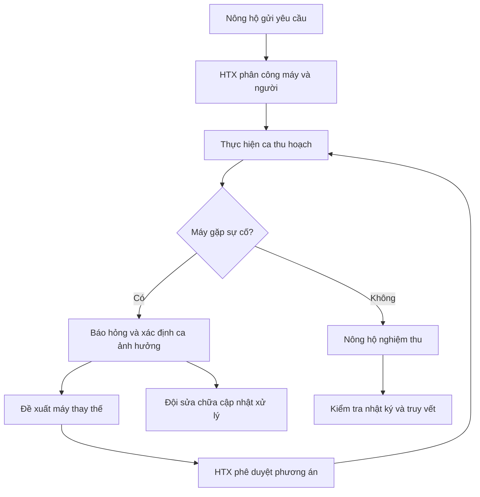
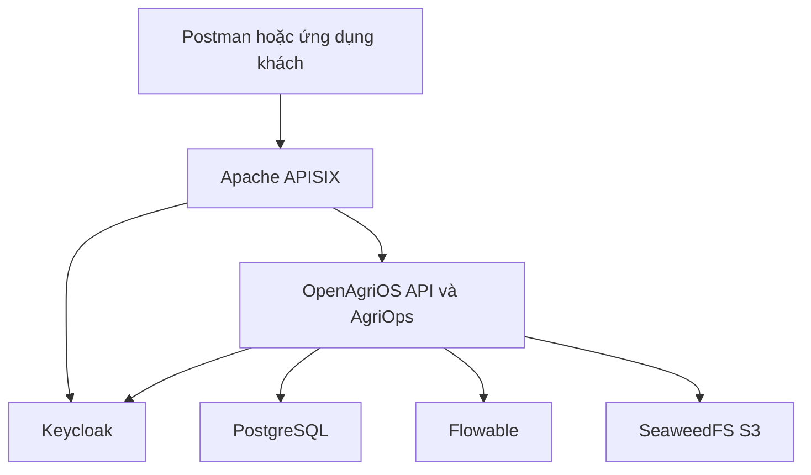

<div align="center">

# OpenAgriOS

**Nền tảng nguồn mở điều phối cơ giới hóa nông nghiệp**

### Một nền tảng. Nhiều bên phối hợp. Một quy trình xuyên suốt.

Nông hộ · Hợp tác xã · Người vận hành · Đội sửa chữa

[](LICENSE)
[](CHANGELOG.md)
[](pom.xml)
[](compose.yaml)
[](docs/api-spec.md)

[**Khám phá**](#overview) · [**Kiến trúc**](#architecture) · [**Chạy thử**](#quickstart) · [**Demo**](#demo) · [**Mức độ hoàn thiện**](#verification) · [**DX-OS**](#dx-os) · [**Đóng góp**](#contributing)

</div>

---

<a id="overview"></a>

## 🌱 Khi một chiếc máy dừng, cả lịch thu hoạch có thể thay đổi

Ai tiếp nhận sự cố? Ca nào bị ảnh hưởng? Máy nào có thể tiếp tục công việc? Ai xác nhận kết quả?

**OpenAgriOS kết nối những câu trả lời đó thành một quy trình có thể theo dõi.** Nông hộ gửi yêu cầu, hợp tác xã điều phối, người vận hành thực hiện và đội sửa chữa xử lý sự cố. Mỗi bước gắn với người phụ trách và lịch sử xử lý.

> **Trọng tâm dự án:** xây dựng lõi dịch vụ dùng chung và ứng dụng **AgriOps** để điều phối cơ giới hóa nông nghiệp — từ yêu cầu đầu tiên đến nghiệm thu cuối cùng.

| 👨‍🌾 Nông hộ | 📋 Hợp tác xã | 🚜 Người vận hành | 🛠️ Đội sửa chữa |
|:---|:---|:---|:---|
| Gửi yêu cầu, xác nhận dịch vụ | Phân công, duyệt phương án thay thế | Nhận ca, báo cáo sự cố | Chẩn đoán, cập nhật sửa chữa |

**Trạng thái:** Headless Core MVP · Thao tác qua API/Postman · Dữ liệu demo mô phỏng. Phiên bản được mô tả: `v0.1.0-alpha`. Sơ đồ thể hiện luồng nghiệp vụ và kiến trúc dự kiến; không phải bằng chứng hệ thống đã chạy đầy đủ.

Dự án phát triển theo hướng **DX-OS Open-Core**: lớp dịch vụ lõi có thể tái sử dụng và ứng dụng **AgriOps** triển khai nghiệp vụ cơ giới hóa. “OS” thể hiện định hướng điều phối hoạt động số. Khả năng tái sử dụng cho lĩnh vực khác cần được chứng minh bằng ứng dụng mở rộng cụ thể.

## ✨ Tính năng nổi bật

Các năng lực dưới đây được mô tả trong tài liệu MVP. Xem [mức độ hoàn thiện và bằng chứng](#verification) để phân biệt mô tả thiết kế với kết quả đã kiểm chứng.

<table>
<tr>
<td width="50%" valign="top">
<h3>🔐 Định danh và phân quyền</h3>
<p>Đăng nhập qua Keycloak OIDC. Phân biệt nông hộ, điều phối viên, người vận hành và đội sửa chữa theo vai trò và tổ chức.</p>
<code>OIDC</code> · <code>RBAC</code> · <code>RLS</code>
</td>
<td width="50%" valign="top">
<h3>📅 Yêu cầu và điều phối</h3>
<p>Tiếp nhận nhu cầu thu hoạch, ghép máy với người vận hành và kiểm tra xung đột khung giờ.</p>
<code>Service Requests</code> · <code>Scheduling</code>
</td>
</tr>
<tr>
<td width="50%" valign="top">
<h3>🛠️ Sự cố và sửa chữa</h3>
<p>Ghi nhận máy hỏng, mô tả hiện trường và thông tin minh chứng. Đội sửa chữa cập nhật chẩn đoán, xử lý.</p>
<code>Incident</code> · <code>Repair</code> · <code>S3</code>
</td>
<td width="50%" valign="top">
<h3>🔄 Phương án thay thế</h3>
<p>Xác định ca bị ảnh hưởng và xếp hạng máy thay thế theo tiêu chí. Điều phối viên xem xét, phê duyệt phương án.</p>
<code>Haversine</code> · <code>BPMN</code>
</td>
</tr>
<tr>
<td width="50%" valign="top">
<h3>✅ Nghiệm thu dịch vụ</h3>
<p>Nông hộ xác nhận kết quả công việc và liên kết nghiệm thu với ca thực hiện.</p>
<code>Acceptance</code> · <code>Workflow</code>
</td>
<td width="50%" valign="top">
<h3>🔎 Nhật ký và truy vết</h3>
<p>Theo dõi chuỗi xử lý, kiểm tra tính toàn vẹn nhật ký bằng chuỗi băm và cung cấp biểu diễn thực thể NGSI-LD.</p>
<code>SHA-256</code> · <code>Lineage</code> · <code>NGSI-LD</code>
</td>
</tr>
</table>

## 💡 Giá trị kỹ thuật cốt lõi

**Lõi dùng chung, nghiệp vụ tách riêng.** Định danh, gateway, workflow và dữ liệu nằm trong `core/`; AgriOps triển khai bài toán cơ giới hóa. Đây là hướng tổ chức để mở rộng ứng dụng trên nền tảng.

**Điều phối cả khi có gián đoạn.** Demo tập trung vào tình huống máy hỏng và chuỗi phối hợp giữa người vận hành, điều phối viên, đội sửa chữa và nông hộ.

**Có thể xem lại quá trình xử lý.** Yêu cầu, ca làm việc, sự cố và nghiệm thu được liên kết để hỗ trợ đối chiếu và kiểm thử.

<a id="demo"></a>

## 🎬 Kịch bản demo

### Tình huống: máy M01 hỏng, dịch vụ cần được tiếp tục

**Mục tiêu:** minh họa việc phối hợp giữa nhiều bên từ báo hỏng đến tiếp tục dịch vụ và nghiệm thu.



| Tình huống | Điều cần kiểm tra |
|:---|:---|
| **Luồng thành công** | Tạo yêu cầu → phân công → xử lý sự cố → duyệt thay thế → nghiệm thu |
| **Sai quyền** | Nông hộ tự điều phối bị từ chối `403` |
| **Trùng lịch** | Máy hoặc người bị xếp trùng giờ được xử lý theo ràng buộc lịch; mẫu repo có `409` |
| **Không có máy phù hợp** | Ghi nhận không có phương án, để điều phối viên xử lý tiếp |

Dùng mã đối tượng thực tế từ phản hồi; không mặc định mọi lần chạy đều có cùng mã sự cố hoặc ca thay thế. Xem [hướng dẫn demo](docs/demo-guide.md).

<a id="architecture"></a>

## 🧩 Kiến trúc hệ thống



Sơ đồ mô tả các thành phần và quan hệ tích hợp chính, không thể hiện mọi chi tiết triển khai hay ranh giới module trong mã nguồn.

| Lớp | Thành phần | Trách nhiệm |
|:---|:---|:---|
| **Ứng dụng nghiệp vụ** | AgriOps | Yêu cầu, điều phối, sự cố, sửa chữa, nghiệm thu |
| **Dịch vụ lõi** | Identity, Gateway, Workflow, Data Services | Năng lực dùng chung cho ứng dụng |
| **Hạ tầng** | Keycloak, APISIX, PostgreSQL, Flowable, SeaweedFS | Định danh, kết nối, lưu trữ và quy trình |

Xem [kiến trúc chi tiết](docs/architecture.md). Khoảng cách được xử lý bằng Haversine trong Java; phiên bản được tài liệu hóa hiện chưa dùng PostGIS cho tìm kiếm không gian.

## ⚙️ Công nghệ sử dụng

<p>


</p>

<details>
<summary><b>Xem phiên bản và vai trò từng thành phần</b></summary>

| Thành phần | Phiên bản được tài liệu hóa | Vai trò |
|:---|:---|:---|
| Java / OpenJDK | 21 LTS | Runtime ứng dụng |
| PostgreSQL | 16.2-alpine | Dữ liệu, RLS và ràng buộc lịch |
| Keycloak | 24.0.5 | Định danh OIDC |
| Apache APISIX | 3.9.0-debian | Cổng API |
| Flowable REST | 7.0.0 | Quy trình BPMN |
| SeaweedFS | 3.64 | Lưu trữ tương thích S3 |
| Maven | Theo môi trường build | Build và kiểm thử |

Đối chiếu [compose.yaml](compose.yaml) và [pom.xml](pom.xml) khi cập nhật phiên bản. Giấy phép của phụ thuộc được quản lý riêng trong [THIRD_PARTY_NOTICES.md](THIRD_PARTY_NOTICES.md).

</details>

<a id="quickstart"></a>

## 🚀 Bắt đầu nhanh

**Chuẩn bị:** Git, Docker Engine và Docker Compose V2, kết nối mạng để tải image/phụ thuộc, Postman hoặc `curl`. Trên Windows, mở Docker Desktop trước khi chạy lệnh. Build bằng Dockerfile không yêu cầu cài Java/Maven trực tiếp trên máy chủ.

### 1. Lấy mã nguồn

```bash
git clone https://github.com/openagrios-hou/Openagrios.git
cd Openagrios
```

### 2. Build và khởi động

```bash
docker version
docker compose version
docker compose -f compose.yaml config --quiet
docker compose -f compose.yaml up -d --build
docker compose -f compose.yaml ps -a
```

Lệnh `up` hoàn tất chưa bảo đảm API sẵn sàng. Nếu chưa có phản hồi, kiểm tra trạng thái container và log.

### 3. Kiểm tra API

```bash
curl -i http://127.0.0.1:8000/api/v1/health
```

Trên PowerShell, dùng `curl.exe` thay `curl`. Kết quả mong đợi: HTTP **200** và `"status": "HEALTHY"`.

| Địa chỉ local | Mục đích |
|:---|:---|
| `http://127.0.0.1:8000/` | Giới thiệu và danh mục Core API |
| `http://127.0.0.1:8000/api/v1/health` | Kiểm tra Health |
| `http://127.0.0.1:9080/` | API Gateway theo cổng mặc định |
| `http://127.0.0.1:8080/` | Keycloak theo cấu hình local |

Cổng thực tế lấy từ `docker compose ps -a`. Endpoint gốc trả JSON là hành vi của Headless API. Kiểm thử Core trực tiếp ở cổng 8000 và đường qua gateway là hai phép kiểm tra riêng; kết quả ở một đường không chứng minh đường còn lại hoạt động.

<details>
<summary><b>🔧 Trùng cổng 9080 hoặc cần xem log</b></summary>

Tạo `compose.local-ports.yaml` ở thư mục repo để đổi gateway sang cổng 9082:

```yaml
services:
  apisix:
    ports: !override
      - "127.0.0.1:9082:9080"
```

Cần Docker Compose hỗ trợ `!override` từ 2.24.4. Khi dùng override, giữ cả hai tệp trong mọi lệnh:

```bash
docker compose -f compose.yaml -f compose.local-ports.yaml up -d --build
docker compose -f compose.yaml -f compose.local-ports.yaml ps -a
docker compose -f compose.yaml -f compose.local-ports.yaml logs --tail 60 core-api flowable apisix
```

Gateway lúc này ở `http://127.0.0.1:9082/`. Kiểm tra dịch vụ đang dùng cổng trước khi dừng hoặc thay đổi cấu hình.

</details>

<details>
<summary><b>⏹️ Dừng môi trường và giữ dữ liệu</b></summary>

```bash
docker compose -f compose.yaml stop
```

Nếu dùng override, thêm tệp override vào lệnh. Tránh `down -v` khi cần giữ dữ liệu trong volume. Health thành công là kiểm tra ban đầu; vẫn cần chạy các luồng xác thực và nghiệp vụ.

</details>

## 🧪 API và kiểm thử

### Đăng nhập thử

**POST** `http://127.0.0.1:8000/api/v1/auth/login` · **No Auth** · **Body raw JSON**

```json
{
  "username": "farmer_ba",
  "password": "123456"
}
```

Dùng `access_token` trả về làm Bearer Token cho **GET** `/api/v1/auth/userinfo`. Mật khẩu trên chỉ dành cho dữ liệu demo local.

<details>
<summary><b>👥 Tài khoản demo theo vai trò</b></summary>

| Tài khoản | Vai trò | Công việc |
|:---|:---|:---|
| `farmer_ba` | FARMER | Gửi yêu cầu, nghiệm thu |
| `coord_htx01` | COORDINATOR | Điều phối tổ chức thứ nhất |
| `op_minh` | OPERATOR | Người vận hành trong kịch bản M01 |
| `op_nam` | OPERATOR | Người vận hành máy thay thế |
| `repair_01` | REPAIR_TEAM | Cập nhật sửa chữa |
| `coord_htx02` | COORDINATOR | Kiểm thử ngữ cảnh tổ chức thứ hai |

Mật khẩu mẫu `123456`. Đối chiếu cấu hình realm và endpoint tài khoản ở phiên bản đang chạy. Không dùng thông tin demo cho môi trường công khai.

</details>

<details>
<summary><b>📬 Dùng Collection trong Postman</b></summary>

Bộ request ở [tests/postman](tests/postman). Import Collection JSON nếu giao diện hỗ trợ, hoặc mở bộ YAML tương ứng trong Local Mode.

Nếu cần chuyển từ JSON v2.1 sang YAML v3:

```bash
postman collection migrate "duong-dan-collection.json" --output "Postman_OpenAgriOS_V3"
```

Thay đường dẫn bằng tệp thực tế. Đặt biến Collection `base_url` thành `http://127.0.0.1:8000` để test Core trực tiếp, hoặc cổng gateway nếu kiểm tra đường qua APISIX.

Trong Scripts → Post-response của đăng nhập nông hộ:

```javascript
pm.test("Login returns token", function () {
    pm.response.to.have.status(200);
    const data = pm.response.json();
    pm.expect(data.access_token).to.be.a("string").and.not.empty;
    pm.collectionVariables.set("farmer_token", data.access_token);
});
```

Các vai trò khác lưu riêng `coord_token`, `op_token`, `repair_token`. Gửi từng request trước khi chạy cả nhóm. Đặt `sim/reset` riêng vì thao tác này khôi phục dữ liệu demo.

</details>

<details>
<summary><b>🧰 Bộ kiểm thử và cách đọc kết quả</b></summary>

- [AcceptanceTestRunner.java](tests/AcceptanceTestRunner.java): bộ kiểm thử chấp nhận được tài liệu hóa trong repo.
- [tests/postman](tests/postman): request và các tình huống API.
- `tests/e2e_full_stack_test.sh`: script kiểm thử tích hợp được tài liệu hóa; đọc script trước vì có bước dọn dẹp volume.

Với Java 21 và Maven được cài trên môi trường chạy:

```bash
mvn clean compile
mvn test
```

Kiểm tra `pom.xml` để biết test nào được thực thi. Kết quả chạy mock và kết quả tích hợp dịch vụ thật phải được ghi riêng. Khi báo cáo PASS/FAIL, đính kèm commit, môi trường và log lần chạy; không dùng một tỷ lệ PASS cố định cho mọi phiên bản.

</details>

Tra cứu endpoint, quyền và payload tại [đặc tả API](docs/api-spec.md). Danh mục API cũng được server cung cấp ở `/`.

### Nhóm API chính

| Nhóm | Endpoint tiêu biểu |
|---|---|
| Khám phá | `GET /`, `GET /api/v1/health` |
| Định danh | `POST /api/v1/auth/login`, `GET /api/v1/auth/userinfo` |
| PKCE | `/api/v1/auth/pkce/authorize-url`, `/authorize-code`, `/token` trong cùng tiền tố `/api/v1/auth/pkce` |
| Trạng thái | `GET /api/v1/state`, `GET /api/v1/digital-twin/entities` |
| Yêu cầu và phân công | `POST /api/v1/requests`, `POST /api/v1/assignments` |
| Sự cố | `POST /api/v1/incidents` |
| Thay thế và sửa chữa | `POST /api/v1/incidents/{id}/approve-replan`, `POST /api/v1/incidents/{id}/repair` |
| Nghiệm thu | `POST /api/v1/acceptances` |
| Truy vết | `GET /api/v1/audit/verify`, `GET /api/v1/audit/lineage/{correlation_id}` |
| Công cụ demo | `POST /api/v1/sim/tick`, `POST /api/v1/sim/reset` |

Danh mục chi tiết, quyền và payload xem [docs/api-spec.md](docs/api-spec.md) và request mẫu trong repo. Endpoint gốc `/` của server cũng cung cấp danh mục để đối chiếu. Không chạy `sim/reset` giữa kịch bản nếu cần giữ trạng thái đã tạo.

<a id="verification"></a>

## 📋 Mức độ hoàn thiện và bằng chứng

**Trạng thái bằng chứng:** README hiện chưa kèm commit và log của một lần chạy xác nhận. “Được mô tả” trong bảng dưới đây không đồng nghĩa đã kiểm thử thành công. Chưa đủ thông tin để xác định tính năng nào đang chạy thật, dùng mock hoặc chưa triển khai.

| Năng lực được mô tả | Cách xác minh | Bằng chứng còn cần bổ sung |
|:---|:---|:---|
| Keycloak OIDC, vai trò và tổ chức | Đăng nhập từng vai trò; kiểm tra token; thử truy cập chéo HTX | Cấu hình chạy thật, phản hồi API, log kiểm thử quyền |
| Yêu cầu và phân công | Tạo yêu cầu; xếp lịch hợp lệ và trùng giờ cho máy/người | ID giao dịch, phản hồi thành công và `409` |
| Sự cố và phương án thay thế | Báo hỏng M01; kiểm tra ca ảnh hưởng; duyệt phương án | Trạng thái trước/sau; ca không có máy phù hợp |
| Workflow BPMN | Theo dõi quy trình tương ứng trong Flowable | Process instance, task và lịch sử chuyển trạng thái |
| Lưu trữ minh chứng | Tải tệp lên S3 và đọc lại bằng quyền phù hợp | Object key, kết quả đọc lại; trường hợp bị từ chối |
| Nghiệm thu và truy vết | Nghiệm thu đúng vai trò; xác minh chuỗi và lineage | Kết quả API, thử phát hiện nhật ký bị sửa trong môi trường test |
| Tích hợp toàn luồng | Chạy kịch bản qua APISIX với các dịch vụ thật | Commit, cấu hình, báo cáo và log của lần chạy |

### Mẫu ghi nhận một lần kiểm thử

Điền bằng kết quả thực tế trước khi công bố báo cáo; không dùng số liệu giả lập làm thành tích kiểm thử.

| Trường | Giá trị cần ghi |
|:---|:---|
| Commit / tag | Chưa ghi nhận |
| Ngày chạy và người thực hiện | Chưa ghi nhận |
| Môi trường và phiên bản Compose | Chưa ghi nhận |
| Chế độ | Ghi rõ mock hoặc dịch vụ thật cho từng thành phần |
| Đường truy cập | Core trực tiếp / gateway; báo cáo riêng từng đường |
| Kết quả | Số ca đạt, thất bại, bỏ qua và nguyên nhân |
| Bằng chứng | Đường dẫn log, báo cáo hoặc video gắn với đúng commit |

<a id="dx-os"></a>

## 🎯 Định hướng DX-OS và chuẩn bị dự thi

OpenAgriOS chọn bài toán điều phối cơ giới hóa của HTX để thể hiện sự phối hợp giữa con người, quy trình và dữ liệu trên lõi dịch vụ dùng chung.

Bảng dưới là **đối chiếu đề xuất của dự án** với H-P-D-I, dựa trên [giới thiệu DX-OS của VFOSSA](https://vfossa.vn/tin-tuc/gioi-thieu-mo-hinh-dx-os-va-chu-de-cuoc-thi-phan-mem-nguon-mo-olp-2026-761.html). Đây chưa phải kết luận đáp ứng toàn bộ đề thi.

| Không gian | Thành phần liên quan trong tài liệu dự án | Demo / bằng chứng cần có | Khoảng trống cần làm rõ |
|:---|:---|:---|:---|
| **H — Nhân sự** | Keycloak, vai trò, ngữ cảnh HTX | Đăng nhập và thao tác theo từng vai trò | Chưa mô tả đầy đủ môi trường cộng tác và quản trị tri thức |
| **P — Quy trình** | AgriOps, Flowable, ràng buộc lịch | Yêu cầu → phân công → sự cố → duyệt → nghiệm thu | Cần chứng minh BPMN điều phối luồng thật và xử lý ngoại lệ |
| **D — Dữ liệu** | PostgreSQL, S3, nhật ký, biểu diễn NGSI-LD | Truy vết xuyên suốt một giao dịch | Cần bằng chứng liên kết dữ liệu và công cụ theo dõi cho quản lý |
| **I — Trí tuệ nhân tạo** | Chưa có thành phần AI được tài liệu hóa | Chưa có demo AI để đánh giá | Haversine và xếp hạng theo quy tắc chưa đủ chứng minh năng lực AI |

### Hồ sơ cần hoàn thiện

- [ ] Đối chiếu sản phẩm với đề thi chính thức và các cập nhật của ban tổ chức.
- [ ] Kiểm tra LICENSE, thông báo bản quyền và giấy phép phụ thuộc/tài sản dữ liệu.
- [ ] Chạy từ bản clone sạch; xác nhận các liên kết tài liệu và bộ request tồn tại.
- [ ] Đính kèm kết quả kiểm thử theo commit, phân biệt mock và dịch vụ thật.
- [ ] Chuẩn bị demo luồng chính, sai quyền, trùng lịch và không có máy thay thế.
- [ ] Bổ sung danh sách thành viên, giảng viên hướng dẫn và kênh liên hệ đã xác nhận.

## 🗂️ Tổ chức mã nguồn

```text
Openagrios/
├── core/                 # Identity, Gateway, Workflow, Data Services
├── apps/agriops/         # Nghiệp vụ cơ giới hóa nông nghiệp
├── infra/                # APISIX, BPMN, PostgreSQL, Keycloak
├── docs/                 # Kiến trúc, API, demo và bảo mật
├── tests/                # Acceptance tests và Postman
├── .github/              # Workflows và mẫu issue
├── compose.yaml          # Môi trường local
├── compose.prod.yaml     # Cấu hình triển khai bổ sung
├── Dockerfile            # Build ứng dụng
└── pom.xml               # Cấu hình Maven
```

## 📊 Dữ liệu và phạm vi MVP

Demo sử dụng dữ liệu mô phỏng về nông hộ, vùng canh tác, máy, người vận hành, yêu cầu dịch vụ và ca làm việc. Điểm vào hiện tại là **Headless API**, thao tác bằng Postman hoặc ứng dụng khách.

<details>
<summary><b>Xem giới hạn hiện tại và hướng hoàn thiện</b></summary>

- Tên địa phương hay HTX trong demo không phải bằng chứng đã triển khai thực tế.
- Dữ liệu, ảnh và tài sản bên ngoài cần ghi nguồn và quyền sử dụng riêng.
- Chuỗi băm hỗ trợ kiểm tra tính toàn vẹn; không phải cam kết bất biến tuyệt đối hay chứng nhận pháp lý.
- Biểu diễn NGSI-LD không tự chứng minh tuân thủ toàn bộ đặc tả hoặc có mô hình 3D. Minh chứng tệp cần được kiểm tra lưu và đọc lại trên S3.
- Chưa công bố kết quả độc lập về hiệu năng hay hiệu quả kinh tế.

Ưu tiên tiếp theo: kiểm thử tích hợp toàn luồng, chuẩn hóa dữ liệu mẫu, khảo sát nghiệp vụ HTX và phát triển ứng dụng khách.

</details>

## 📚 Tài liệu dự án

| Tài liệu | Nội dung |
|:---|:---|
| [Kiến trúc](docs/architecture.md) | Thành phần và quan hệ tích hợp |
| [REST API](docs/api-spec.md) | Endpoint, payload và mã phản hồi |
| [Kịch bản demo](docs/demo-guide.md) | Thứ tự thao tác và tình huống |
| [Bảo mật](docs/security.md) | Cấu hình và triển khai |
| [Changelog](CHANGELOG.md) | Lịch sử thay đổi |
| [Third party notices](THIRD_PARTY_NOTICES.md) | Thành phần và giấy phép liên quan |

<a id="contributing"></a>

## 🤝 Đóng góp

Bạn có thể tham gia kiểm thử, cải thiện tài liệu, chuẩn hóa dữ liệu, hoàn thiện workflow hoặc phát triển ứng dụng khách.

1. Đọc [CONTRIBUTING.md](CONTRIBUTING.md) và quy tắc repo.
2. Fork repo hoặc tạo nhánh nếu đã có quyền ghi.
3. Thực hiện thay đổi và chạy kiểm tra phù hợp.
4. Gửi Pull Request với mô tả và bằng chứng kiểm thử.

[Báo lỗi](https://github.com/openagrios-hou/Openagrios/issues) · [Xem mã nguồn](https://github.com/openagrios-hou/Openagrios) · [Hướng dẫn đóng góp](CONTRIBUTING.md)

Khi báo lỗi, cung cấp bước tái hiện, kết quả mong đợi, môi trường và log đã loại bỏ token, bí mật hoặc dữ liệu cá nhân.

## 📄 Giấy phép và ghi nhận

Mã nguồn dự án được phân phối theo **[Apache License 2.0](LICENSE)**. Các thành phần phụ thuộc giữ giấy phép tương ứng; xem [THIRD_PARTY_NOTICES.md](THIRD_PARTY_NOTICES.md).

Giấy phép mã nguồn không tự áp dụng cho ảnh, bản đồ, mô hình hoặc dữ liệu bên ngoài. Ghi rõ nguồn, giấy phép và phạm vi sử dụng của từng tài sản khi bổ sung.

Ghi nhận các công nghệ Java/OpenJDK, PostgreSQL, Keycloak, Apache APISIX, Flowable và SeaweedFS. Thành viên và giảng viên hướng dẫn: **chờ nhóm xác nhận**. Kênh trao đổi kỹ thuật: [GitHub Issues](https://github.com/openagrios-hou/Openagrios/issues). Demo công khai: **chưa có URL được xác nhận**.

---

<div align="center">

**🌾 OpenAgriOS**

*Kết nối nguồn lực — phối hợp công việc — theo dõi mùa vụ.*

[Source code](https://github.com/openagrios-hou/Openagrios) · [Issues](https://github.com/openagrios-hou/Openagrios/issues) · [Contributing](CONTRIBUTING.md)

</div>
