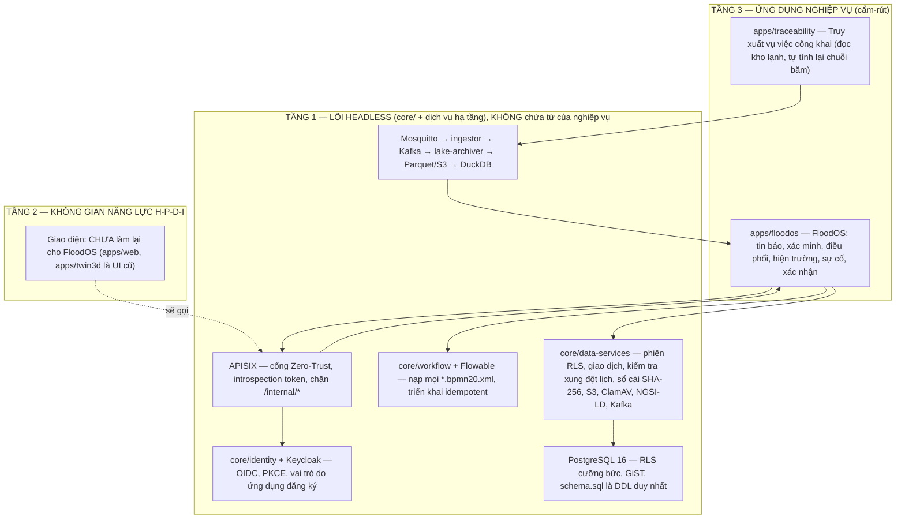

# FloodOS — Kiến trúc hệ thống (DX-OS Open-Core)

FloodOS theo mô hình **DX-OS Open-Core** của đề thi OLP 2026: tách **Nền tảng dịch vụ lõi (Tầng 1, headless PaaS)**, **Không gian năng lực số H-P-D-I (Tầng 2)** và **Ứng dụng nghiệp vụ cắm-rút (Tầng 3)**. Ứng dụng minh họa **FloodOS** điều phối ứng phó ngập lụt cho một địa bàn thí điểm tại Hà Nội và chạy hoàn toàn trên Tầng 1.

> Trạng thái từng thành phần (Có / Mô phỏng / Chưa có) nằm ở [README, mục 3](../README.md). Tài liệu này mô tả thiết kế và nói rõ phần nào chưa làm.

  

> **Lưu ý về hình SVG**: `assets/*.svg` được vẽ cho nguyên mẫu thu hoạch lúa; nhãn nghiệp vụ trong ảnh chưa được vẽ lại. Sơ đồ Mermaid dưới đây phản ánh đúng mã nguồn hiện tại.

---

## 1. Tầng 1 — Lõi dịch vụ số (headless)

| Mô-đun | Việc làm | Ranh giới |
|---|---|---|
| [`core/identity`](../core/identity/KeycloakOidcEngine.java) | OIDC/OAuth2, PKCE (RFC 7636/9700), xác thực JWT | Danh sách vai trò do **ứng dụng đăng ký** lúc khởi động (`configureRoleHierarchy`); token không có vai trò đã đăng ký hoặc thiếu `organization_id` bị từ chối; id người dùng là `usr_<username>`. |
| [`core/api-gateway`](../core/api-gateway/ZeroTrustGateway.java) | Kiểm tra RBAC và ghi `RBAC_BLOCKED_*` vào sổ cái; dựng header Zero-Trust | Nhận danh sách vai trò được phép từ lời gọi. |
| [`core/workflow`](../core/workflow/BpmnWorkflowEngine.java) | Nạp **mọi** `*.bpmn20.xml` trong `infra/bpmn/`; triển khai lên Flowable lúc khởi động, đặt tên bản triển khai theo hash nội dung nên khởi động lại không tạo bản trùng; khởi tạo tiến trình; bản sao trạng thái từng bước; `restoreInstance` dựng lại bản sao từ bảng nghiệp vụ sau khi khởi động lại | Không biết tên quy trình nào. **Giới hạn thật:** chưa hoàn tất user task qua REST của Flowable. |
| [`core/data-services`](../core/data-services/) | `PostgreSqlDataService` (kết nối, phiên RLS `app.current_org_id/_user_role/_user_id`, giao dịch, kiểm tra bảng tồn tại, bảng nền tảng `organizations/users/audit_records`); `ScheduleConflictEngine` (tài nguyên + người giữ + khoảng thời gian, nửa mở như GiST); `SpatialMatchingEngine` (Haversine, đa giác); `ImmutableAuditLedger`; `SeaweedS3StorageService`; `MalwareScanner`; `NgsiLdTwinMapper`; `EventBusPublisher`; `AnalyticsLakeClient` | Không có SQL của nghiệp vụ, không có DDL. Kiểm thử ranh giới quét `core/` và thất bại nếu thấy từ của miền. |

### Luồng dữ liệu nóng/lạnh

- **Nóng:** giao dịch trong PostgreSQL; mỗi bản ghi audit và mỗi mẫu telemetry được phát bất đồng bộ lên Apache Kafka (qua Karapace REST).
- **Lạnh:** [`services/lake-archiver`](../services/lake-archiver/archiver.py) gom lô thành Parquet (phân vùng `dt=`) trên SeaweedFS S3; DuckDB truy vấn trực tiếp, khử trùng lặp vì giao nhận at-least-once. Telemetry nằm ở tiền tố riêng `asset_telemetry/` (mỗi dòng có `asset_kind`, `asset_id`, `source`); các tệp theo bố cục máy gặt cũ, nếu còn trong volume, không bao giờ bị trộn vào. Truy vấn: `summary`, `actions-by-day`, `asset-utilization`, `water-level-summary` (tên truy vấn thêm do ứng dụng khai báo, lõi chỉ biết `summary` và `actions-by-day`).
- Chưa dùng Iceberg/Trino: lựa chọn gọn cho MVP, không phải lớp lakehouse đầy đủ.

### Thu nhận dữ liệu OT

Thiết bị phát MQTT lên `floodos/<org>/vehicles/<id>/telemetry` hoặc `floodos/<org>/gauges/<id>/telemetry`. Mosquitto bắt buộc xác thực, ACL tối thiểu (thiết bị chỉ ghi, ingestor chỉ đọc; tài khoản và ACL sinh lại từ biến môi trường mỗi lần khởi động). [`ingestor.py`](../services/telemetry/ingestor.py) kiểm tra kiểu, đối chiếu `org`/`id` trong topic với payload và **bắt buộc nhãn `source` ∈ {SIMULATOR, DEVICE}**, rồi gọi endpoint nội bộ của core bằng bí mật dùng chung; core kiểm tra miền giá trị và tenant, cập nhật bản sao số, ghi PostgreSQL (giới hạn 10 giây/tài sản) và phát lên Kafka. Telemetry **không bao giờ** đổi trạng thái do quy trình quản. Trạm đo cập nhật mực nước và mức rủi ro của vùng, kèm nguồn.

### Cổng chặn mã độc

Ảnh do client gửi được quét qua `clamd` (INSTREAM) **trước khi lưu**: nhiễm mã độc → `422` + audit `UPLOAD_BLOCKED_MALWARE`; không quét được → `503` fail-closed; không phải ảnh → `415`. Production đặt `FLOODOS_MALWARE_SCAN=REQUIRED` nên lõi không khởi động nếu thiếu ClamAV. Giới hạn: quét ở lớp dịch vụ, chưa ở plugin APISIX.

### Schema và dữ liệu

[`infra/db/schema.sql`](../infra/db/schema.sql) là nguồn duy nhất của DDL và chính sách RLS, được [`docker-entrypoint-sync.sh`](../infra/db/docker-entrypoint-sync.sh) áp dụng lại mỗi lần container khởi động. `FloodDataStore` chờ có hạn cho database và schema (production) rồi dừng nếu thiếu bảng; không tạo bảng. Dữ liệu demo do `FloodDataStore.resetAndSeed()` nạp khi database trống; danh tính do `infra/keycloak/floodos-realm.json`; một kiểm thử bắt buộc hai danh sách trùng nhau.

---

## 2. Tầng 3 — FloodOS (`apps/floodos`)

| Lớp | Lớp Java | Trách nhiệm |
|---|---|---|
| Vai trò | [`FloodRoles`](../apps/floodos/FloodRoles.java) | 5 vai trò, đăng ký với lõi |
| Mô hình | [`FloodModels`](../apps/floodos/FloodModels.java) | vùng, tin báo, đội, xe, lệnh, sự cố, kết quả, điểm trú, trạm đo; mọi con số có nhãn nguồn |
| Lưu trữ | [`FloodRepository`](../apps/floodos/FloodRepository.java), [`FloodDataStore`](../apps/floodos/FloodDataStore.java) | một hành động nghiệp vụ = một giao dịch dưới ngữ cảnh RLS của người gọi; production: ghi lỗi thì khôi phục từ database và trả lỗi |
| Nghiệp vụ | [`FloodOSService`](../apps/floodos/FloodOSService.java), [`RescueScoring`](../apps/floodos/RescueScoring.java) | luật, phạm vi theo vai trò, xếp hạng phương án có giải thích |
| Đăng nhập | [`FloodAuthService`](../apps/floodos/FloodAuthService.java) | PKCE, đăng nhập; vai trò không hợp lệ bị từ chối |
| HTTP | [`FloodOSServer`](../apps/floodos/FloodOSServer.java) | định tuyến, không chứa luật |

Quy trình: [`flood_report_lifecycle`](../infra/bpmn/flood_report_lifecycle.bpmn20.xml) (tin báo → xác minh → điều phối → hiện trường → xác nhận, có nhánh từ chối và nhánh phản đối) và [`dispatch_replan`](../infra/bpmn/dispatch_replan.bpmn20.xml) (sự cố → khoanh vùng tự động → duyệt thay thế song song với sửa chữa).

**Xếp hạng phương án thay thế** ([`RescueScoring`](../apps/floodos/RescueScoring.java)): 40 điểm khoảng cách đường chim bay (về 0 ở 15 km), 25 độ phù hợp loại xe với nhu cầu (xe không phù hợp không bao giờ được đưa ra), 20 độ đáp ứng công suất (người so với số người; máy bơm theo quy ước 10 m³/giờ cho mỗi cm nước), 15 đánh giá đội. Đây là **luật có giải thích**, không phải AI; không có định tuyến.

**Quy tắc phạm vi**: dịch vụ Java lọc theo vai trò và quyền sở hữu; PostgreSQL lọc lại bằng RLS với cùng quy tắc (không có chính sách đệ quy: lệnh mang bản sao `reporter_user_id` để chính sách của tin báo và của lệnh không trỏ vào nhau). Riêng thao tác báo sự cố ghi lan sang lệnh/tin của đội khác, nên được ghi dưới quyền `DISPATCHER` trong **cùng đơn vị** của người báo (việc cho phép đã được kiểm tra ở Java trước đó).

## 3. Tầng 2 — H-P-D-I

Giao diện FloodOS **chưa được xây dựng**. [`apps/web`](../apps/web) và [`apps/twin3d`](../apps/twin3d) là giao diện của nguyên mẫu thu hoạch lúa; gateway vẫn phục vụ chúng nhưng chúng không khớp API mới. Thiết kế UX mục tiêu (theo vai trò, di động, trạng thái tải/lỗi/rỗng/dữ liệu cũ, nhãn nguồn dữ liệu trên bản đồ): [`floodos-demo-ux.md`](floodos-demo-ux.md). Đây là đích thiết kế, không phải chức năng đã có.

## 4. Tầng 3 — Truy xuất vụ việc công khai (`apps/traceability`)

Module Python chỉ **đọc kho lạnh**; không có kết nối nào vào PostgreSQL hay lõi. `GET /trace/{correlation_id}` (trang công khai có mã QR), `.json`, `/qr.svg`: đi qua APISIX không cần đăng nhập, chỉ đọc, giới hạn tốc độ. Lõi phát lên Kafka đúng chuỗi byte đã băm; module **tính lại SHA-256 của từng bản ghi** và kiểm tra chuỗi của cả epoch liền mạch từ genesis. Kết quả `VERIFIED` / `PARTIAL` / `FAILED`. Công thức băm được khóa bằng một "vector vàng" dùng chung giữa Java và Python (kiểm thử ở cả hai phía). Trang công khai chỉ hiện vai trò, mã thực thể và mã băm rút gọn, không hiện danh tính.
