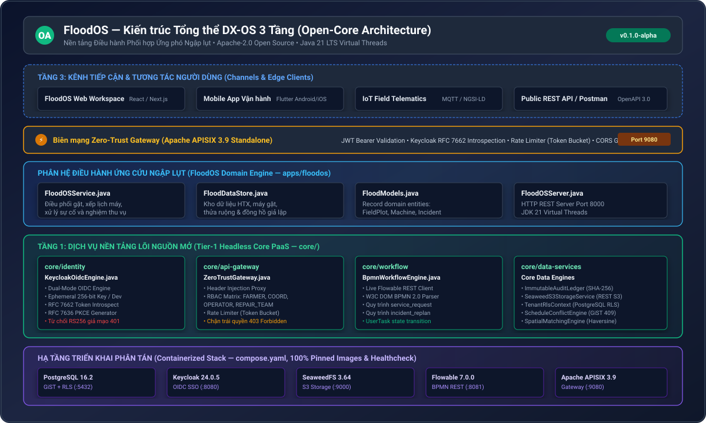
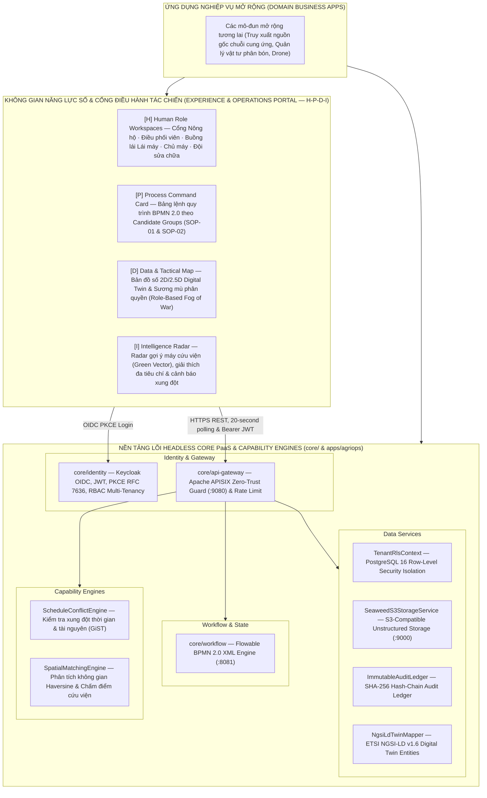

# OpenAgriOS — Kiến Trúc Hệ Thống (DX-OS Open-Core)

OpenAgriOS được thiết kế theo triết lý **DX-OS Open-Core (Digital Transformation Operating System)**: tách bạch hoàn toàn giữa **Nền tảng lõi dùng chung (Headless Core PaaS & Capability Engines)**, **Không gian năng lực số & Cổng điều hành tác chiến đa vai trò (Experience & Operations Portal — H-P-D-I)** và **Ứng dụng nghiệp vụ chuyên ngành cắm-và-chạy (Domain Business Apps)**.

---

## 1. Mô hình Kiến trúc Tổng thể

  

---

## 2. Chi tiết các Phân hệ Kiến trúc

### 2.1. Tầng 1: Nền tảng Lõi Dùng Chung (Headless Core PaaS & Capability Engines)
- **`core/identity` — Quản trị Định danh & Phân quyền (IAM):**
  - OpenID Connect (OIDC 1.0) & OAuth 2.0 trên nền Keycloak 24.0.
  - Luồng chuẩn **Authorization Code Flow với PKCE (RFC 7636)**.
  - Phân quyền theo vai trò (RBAC): `COORDINATOR`, `FARMER`, `OPERATOR`, `MACHINE_OWNER`, `REPAIR_TEAM`.
  - Đa đơn vị thuê (`organization_id` claim) nhúng trực tiếp trong JWT token.
- **`core/api-gateway` — Cổng API Biên mạng Zero-Trust:**
  - Apache APISIX Cloud-Native API Gateway (:9080).
  - Xác thực Token Introspection với Keycloak (RFC 7662), gắn Zero-Trust Headers (`X-User-Id`, `X-Org-Id`, `X-User-Roles`).
- **`core/workflow` — Động cơ Quy trình Nghiệp vụ BPMN 2.0:**
  - Flowable BPMN 2.0 REST Engine (:8081).
  - SOP-01: Vòng đời yêu cầu dịch vụ thu hoạch (`service_request.bpmn20.xml`).
  - SOP-02: Báo sự cố máy hỏng & Tái lập kế hoạch cứu viện (`incident_replan.bpmn20.xml`).
- **`core/data-services` — Dịch vụ Dữ liệu Hợp nhất:**
  - **PostgreSQL 16 RLS**: Phân quyền Row-Level Security ở cấp nhân CSDL, cô lập tuyệt đối dữ liệu giữa các HTX và giữa các Nông hộ.
  - **ScheduleConflictEngine**: Ràng buộc `btree_gist` chống trùng lịch ca gặt theo khung thời gian `tstzrange`.
  - **SpatialMatchingEngine**: Tính toán khoảng cách trắc địa đường chim bay (Haversine) và chấm điểm cứu viện đa tiêu chí.
  - **SeaweedFS S3**: Lưu trữ ảnh minh chứng sự cố và biên bản nghiệm thu qua presigned/safe upload.
  - **ImmutableAuditLedger**: Sổ cái kiểm toán bất biến chuỗi băm SHA-256 và truy vết phả hệ dữ liệu (`correlation_id`).
  - **NgsiLdTwinMapper**: Bản sao số thực thể chuẩn ETSI GS CIM 009 / Smart Data Models.

- **Luồng dữ liệu nóng/lạnh (Hot/Cold Data Plane):**
  - **Nóng**: giao dịch thời gian thực nằm ở PostgreSQL; mỗi bản ghi audit đồng thời được `EventBusPublisher` phát bất đồng bộ lên Apache Kafka qua Kafka REST Proxy/Karapace (`openagrios.audit.v1`).
  - **Lạnh**: `services/lake-archiver` đọc topic, gom lô và ghi Parquet (ZSTD, phân vùng `dt=YYYY-MM-DD`) vào bucket `openagrios-lake` trên SeaweedFS; DuckDB truy vấn trực tiếp các file này (khử trùng lặp theo `ledger_epoch` + `event_id` vì giao nhận at-least-once).
  - Truy cập qua `GET /api/v1/analytics/*` (chỉ điều phối viên/quản trị, cách ly theo `organization_id`). Chưa dùng Iceberg/Trino: đây là lựa chọn gọn cho quy mô MVP, không phải lớp lakehouse đầy đủ.

- **Thu nhận dữ liệu cảm biến OT (MQTT → bản sao số):**
  - Thiết bị phát MQTT lên `openagrios/<org>/machines/<id>/telemetry` (Eclipse Mosquitto, bắt buộc xác thực; ACL quyền tối thiểu: thiết bị chỉ được *publish*, `telemetry-ingestor` chỉ được *subscribe*; tài khoản và ACL được sinh lại từ biến môi trường mỗi lần khởi động).
  - `telemetry-ingestor` kiểm tra schema/kiểu dữ liệu, đối chiếu `org`/`machine` trong topic với payload, rồi gọi endpoint nội bộ của core bằng bí mật dùng chung. Core kiểm tra miền giá trị và quyền sở hữu tenant, cập nhật bản sao số NGSI-LD, ghi PostgreSQL (giới hạn 10 giây/máy) và phát mỗi mẫu lên Kafka → Parquet.
  - Telemetry **không bao giờ** đổi trạng thái do workflow quản (`status`, phân công). Endpoint `/api/v1/internal/*` bị APISIX trả 404 ở biên.
  - **Trung thực về dữ liệu:** dự án không có phần cứng thật. Dịch vụ `device-simulator` (profile `demo`, tắt mặc định) phát dữ liệu GPS/nhiên liệu mô phỏng nhưng đi qua đúng giao thức MQTT có xác thực và đúng đường xử lý như thiết bị thật. Chỉ máy đang `WORKING` mới di chuyển. Khi nối thiết bị thật chỉ cần cấp tài khoản MQTT, không đổi mã nguồn của core.

### 2.2. Không gian Năng lực Số & Cổng Điều hành Tác chiến (Experience & Operations Portal — H-P-D-I)
Ứng dụng web điều hành nghiệp vụ tập trung (`apps/web` - React 18, TypeScript, Tailwind CSS, MapLibre GL JS):
- **[H] Human Role Workspaces:**
  - Shell giao diện tiếng Việt, responsive cho cả Mobile, Tablet và Desktop.
  - 5 Buồng lái cá nhân hóa: Cổng Nông hộ, Trung tâm Chỉ huy Điều phối viên, Buồng lái Hiện trường Lái máy, Cổng Chủ máy, Cổng Kỹ thuật Sửa chữa.
  - Hộp công cụ an toàn: **SSO & RBAC Proof Inspector** (hiển thị claims cho phép, kèm cảnh báo bảo mật).
- **[P] Process Command Card:**
  - Trực quan hóa tiến trình thực tế theo SOP-01 và SOP-02 kết nối Flowable BPMN.
  - Phân loại rõ ràng: Đang chạy, Chờ phê duyệt, Xung đột lịch, Đã hoàn tất.
- **[D] Data & Tactical Map (Fog of War):**
  - Bản đồ 2D/2.5D Digital Twin hiển thị đa giác ruộng và marker máy gặt chuẩn NGSI-LD.
  - Cơ chế Sương mù Phân quyền: Nông hộ chỉ thấy ruộng của mình; các ruộng khác không lộ tọa độ hay polygon.
  - Đường hành quân Waypoints: Xanh dương (Ca đã chốt), Đỏ nhấp nháy (Ca bị đứt gãy).
- **[I] Intelligence Radar:**
  - Vector xanh lá gợi ý máy cứu viện tối ưu (`M02` sang `F03`).
  - Bảng giải thích chi tiết điểm số đa tiêu chí (Sẵn sàng, Công suất, Khoảng cách Haversine đường chim bay, Kỹ năng thợ lái).
  - Cảnh báo xung đột thời gian (`409 Conflict`) và kịch bản biên (`NO_FEASIBLE_UNIT_IN_WINDOW`).
- **Thanh Live Combat Log & Phả hệ Dữ liệu:**
  - Hiển thị nhật ký kiểm toán được làm mới mỗi 20 giây và sơ đồ phả hệ dữ liệu SHA-256.

### 2.3. Tầng 3: Ứng dụng Nghiệp vụ Mở rộng (Domain Business Apps)

Tầng 3 là các module chuyên ngành **cắm-rút**: mỗi module là một dịch vụ riêng, chỉ dùng dữ liệu và API của Tầng 1, không sửa mã lõi.

| Module | Trạng thái | Ghi chú |
|---|---|---|
| **Truy xuất nguồn gốc lúa gạo** (`apps/traceability`) | **Đã triển khai & kiểm thử** | Xem bên dưới |
| Quản lý vật tư phân bón thông minh | Chưa làm | Hướng phát triển |
| Điều phối đội bay drone phun thuốc | Chưa làm | Hướng phát triển |

**Module truy xuất nguồn gốc** (`apps/traceability`, Python, giấy phép phụ thuộc: DuckDB MIT, segno BSD-3-Clause):
- Chỉ **đọc kho lạnh** (Parquet trên S3 do Tầng 1 nạp qua Kafka); không có kết nối nào vào PostgreSQL hay lõi.
- `GET /trace/{ma_lo}` (trang công khai có mã QR), `/trace/{ma_lo}.json`, `/trace/{ma_lo}/qr.svg`: đi qua APISIX không cần đăng nhập, chỉ đọc, giới hạn tốc độ; `ma_lo` là `correlation_id` của lô thu hoạch (nút "Truy xuất nguồn gốc" trong cửa sổ "Xem lịch sử dữ liệu").
- **Tự xác minh độc lập:** lõi phát lên Kafka đúng chuỗi byte đã băm (`before_canonical`, `after_canonical`); dịch vụ truy xuất **tính lại SHA-256 của từng bản ghi** và kiểm tra toàn bộ chuỗi của epoch sổ cái liền mạch từ genesis. Kết quả: `VERIFIED` / `PARTIAL` (bản ghi cũ thiếu dữ liệu gốc) / `FAILED` (có bản ghi bị sửa, xóa hoặc đảo thứ tự). Công thức băm được khóa bằng một "vector vàng" dùng chung giữa Java và Python.
- **Che danh tính:** chỉ hiển thị vai trò, mã thực thể và mã băm rút gọn; không có `actor_user_id`.
- Giới hạn trung thực: dữ liệu minh họa khi chạy ở chế độ demo (trang có ghi chú); chưa có mô hình "lô lúa" riêng (mã lô = mã theo dõi nghiệp vụ); chưa gắn dữ liệu chất lượng/độ ẩm/khối lượng.
