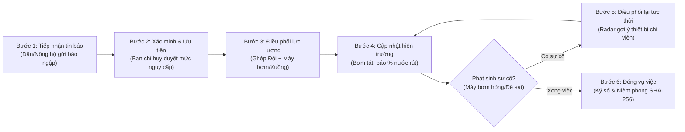

# BẢN RÀ SOÁT UX & THIẾT KẾ LUỒNG DEMO ỨNG PHÓ NGẬP LỤT ĐỊA BÀN
*(Tài liệu rà soát kiến trúc trải nghiệm người dùng — Không chỉnh sửa mã nguồn hệ thống)*

---

## PHẦN 1: ÁNH XẠ KHÁI NIỆM & MÔ HÌNH DỮ LIỆU ĐỊA BÀN

Hệ thống hiện tại của OpenAgriOS được thiết kế cho bài toán **Điều phối cơ giới hóa thu hoạch lúa** (máy gặt, thợ lái, thửa ruộng, ca gặt). Để chuyển dịch mượt mà sang bài toán **Ứng cứu ngập lụt địa bàn** (ví dụ: Vùng trũng ngập ven sông Cần Thơ / đê bao Hải Hậu - Nam Định) mà vẫn kế thừa toàn bộ nền tảng Tầng 1 (Keycloak OIDC, Flowable BPMN, PostgreSQL RLS, SeaweedFS S3, SHA-256 Ledger), bảng ánh xạ thực thể nghiệp vụ được xác lập như sau:

| Khái niệm Thu hoạch (Hiện có) | Khái niệm Ứng phó Ngập lụt (Mô phỏng Demo) | Kiểu dữ liệu / Nguồn dữ liệu |
| :--- | :--- | :--- |
| `FieldPlot` (Thửa ruộng canh tác) | **Điểm ngập úng / Vùng đê bao xung yếu (`FloodZone`)** | Đa giác ranh giới GeoJSON + Tọa độ tâm + Mức ngập cảnh báo. |
| `ServiceRequest` (Yêu cầu gặt) | **Tin báo ngập / Yêu cầu cứu trợ khẩn cấp (`FloodAlert`)** | Người báo, vị trí, mức độ ưu tiên (`URGENT`, `HIGH`, `CRITICAL`), ghi chú hiện trường. |
| `HarvesterMachine` (Máy gặt đập) | **Phương tiện & Thiết bị ứng cứu (`RescueVehicle` / `PumpUnit`)** | Máy bơm dã chiến công suất lớn, xuồng cứu hộ, máy xúc đắp bờ kè. |
| `OperatorProfile` (Thợ lái máy) | **Đội xung kích / Nhân lực vận hành (`RescueTeam`)** | Đội dân quân tự vệ, thợ vận hành máy bơm, tổ trưởng đội cứu hộ. |
| `DispatchAssignment` (Ca gặt) | **Lệnh điều động / Ca bơm tiêu úng (`RescueDispatch`)** | Ghép cặp Thiết bị + Đội cứu hộ + Điểm ngập + Khung giờ tác chiến. |
| `MachineIncident` (Máy hỏng giữa đồng) | **Sự cố hiện trường (`FieldIncident`)** | Máy bơm chết máy, xuồng ngập nước, sạt lở đê phát sinh chặn đường. |
| `CandidateRescueOption` (Máy cứu viện) | **Phương án chi viện dự phòng (`BackupRescueOption`)** | Máy bơm / xuồng rảnh rỗi lân cận theo cự ly trắc địa và công suất. |
| `WorkAcceptance` (Nghiệm thu gặt) | **Biên bản hoàn thành tiêu úng / Khắc phục sự cố (`ReliefCompletion`)** | Đóng vụ việc, xác nhận mực nước rút an toàn, niêm phong sổ cái SHA-256. |

---

## PHẦN 2: THIẾT KẾ CHI TIẾT LUỒNG DEMO 6 BƯỚC



### Bước 1: Tiếp nhận tin báo (Citizen Incident Intake)
- **Chủ thể thực hiện**: Người dân / Nông hộ vùng trũng (Vai trò `FARMER`).
- **Thao tác**:
  1. Người dân truy cập ứng dụng, bấm nút nổi bật **"🚨 Báo điểm ngập khẩn cấp"**.
  2. Chọn vị trí: Điểm ngập thuộc sở hữu của mình (thửa đất/nhà ở) hoặc chấm vị trí trên bản đồ lân cận.
  3. Chọn mức độ nguy cấp: `Khẩn cấp - Nguy cơ tràn đê/sập nhà`, `Cao - Ngập sâu trên 50cm`, `Trung bình - Ngập cục bộ sân vườn`.
  4. Chụp ảnh hiện trường mực nước (gửi qua bộ quét mã độc `MalwareScanner`).
  5. Gửi tin báo → Hệ thống sinh mã theo dõi `ALERT-2026-XXXX`.

### Bước 2: Xác minh & Phân loại ưu tiên (Triage & Verification)
- **Chủ thể thực hiện**: Điều phối viên Ban Chỉ huy PCTT&TKCN Xã/HTX (Vai trò `COORDINATOR`).
- **Thao tác**:
  1. Ban chỉ huy nhận thông báo tức thời (chuông cảnh báo + ticker đỏ).
  2. Xem ảnh hiện trường đã được quét sạch mã độc từ SeaweedFS S3.
  3. Đối chiếu vị trí điểm ngập với danh sách đê bao xung yếu.
  4. Xác nhận mức độ ưu tiên: Đưa tin báo vào hàng đợi xử lý của quy trình Flowable BPMN (`PENDING_DISPATCH`).

### Bước 3: Điều phối Đội & Phương tiện ứng cứu (Resource Dispatch)
- **Chủ thể thực hiện**: Ban Chỉ huy PCTT&TKCN (Vai trò `COORDINATOR`).
- **Thao tác**:
  1. Bấm nút **"Điều động ứng cứu"** trên tin báo.
  2. Modal hiển thị:
     - Danh sách thiết bị sẵn sàng: Máy bơm dã chiến, Xuồng cứu hộ, Máy đào.
     - Danh sách đội cứu hộ: Đội cơ động số 1, Đội xung kích số 2.
     - Khung thời gian triển khai dự kiến (`start_time` → `end_time`).
  3. Hệ thống kiểm tra chống trùng lịch qua `ScheduleConflictEngine`: Nếu máy bơm hoặc đội cứu hộ đã có ca khác trong khung giờ $\rightarrow$ Ngăn chặn tức thời (`HTTP 409 Conflict: RESOURCE_TIME_OVERLAP`).
  4. Phê duyệt điều động $\rightarrow$ Kích hoạt nhiệm vụ BPMN cho đội hiện trường.

### Bước 4: Cập nhật diễn biến hiện trường (Field Operations & Progress)
- **Chủ thể thực hiện**: Đội trưởng đội cứu hộ / Thợ vận hành thiết bị (Vai trò `OPERATOR`).
- **Thao tác**:
  1. Đội cứu hộ nhận ca tác chiến trên điện thoại: Tên điểm ngập, vị trí, loại thiết bị được giao.
  2. Bấm **"Bắt đầu vận hành"** $\rightarrow$ Trạng thái chuyển sang `IN_PROGRESS`.
  3. Định kỳ kéo thanh trượt cập nhật tiến độ tiêu úng / đắp bờ: `25%`, `50%`, `75%`.
  4. Thiết bị bơm phát dữ liệu OT mô phỏng (tọa độ, lượng nhiên liệu còn lại, trạng thái chạy) qua MQTT về bản đồ.

### Bước 5: Điều phối lại khi có sự cố (Field Failure & Re-dispatch)
- **Chủ thể thực hiện**: Đội hiện trường báo cáo $\rightarrow$ Ban chỉ huy phê duyệt cứu viện (Vai trò `OPERATOR` + `COORDINATOR`).
- **Thao tác**:
  1. **Tình huống sự cố**: Máy bơm dã chiến số 1 bị quá nhiệt / gãy cánh quạt hút bùn hoặc vỡ thêm đoạn đê phụ.
  2. Đội vận hành bấm **"Báo sự cố thiết bị"**: Chọn loại sự cố (`PUMP_CLOGGED`, `ENGINE_FAILURE`, `LEVEE_BREACH`), chụp ảnh hiện trường gửi S3.
  3. **Động cơ Radar cứu viện (`IntelligenceRadar.tsx`)** tự động kích hoạt:
     - `SpatialMatchingEngine` quét các máy bơm / xuồng lân cận đang rảnh.
     - Chấm điểm đa tiêu chí: Cự ly đường chim bay ngắn nhất + Công suất bơm lớn nhất + Đội vận hành giàu kinh nghiệm nhất.
     - Đưa ra phương án tối ưu: *"Máy bơm P02 (cách 1.2 km, công suất 1.200 m³/h, độ phù hợp 94/100)"*.
  4. Ban chỉ huy bấm **"Phê duyệt chi viện thay thế"** $\rightarrow$ Ca cũ chuyển thành `SUPERSEDED`, ca mới được kích hoạt tức thời, vẽ đường hành quân chi viện màu xanh nhấp nháy trên bản đồ. Đồng thời tạo phiếu sửa chữa cho Đội kỹ thuật (`REPAIR_TEAM`).

### Bước 6: Nghiệm thu hiện trường & Đóng vụ việc (Acceptance & Audit Sealing)
- **Chủ thể thực hiện**: Người dân vùng ngập + Ban chỉ huy (Vai trò `FARMER` + `COORDINATOR`).
- **Thao tác**:
  1. Nước rút hoàn toàn, nguy cơ vỡ đê đã được giải tỏa. Đội cứu hộ bấm **"Hoàn thành ca"** (`100%`).
  2. Người dân nhận thông báo yêu cầu xác nhận:
     - Kiểm tra hiện trường thực tế.
     - Chấm điểm độ hài lòng (1 đến 5 sao) và để lại phản hồi.
     - Bấm **"Ký biên bản xác nhận an toàn"**.
  3. Sổ cái `ImmutableAuditLedger` tự động liên kết toàn bộ chuỗi sự kiện: từ lúc phát cảnh báo $\rightarrow$ duyệt $\rightarrow$ điều động $\rightarrow$ sự cố $\rightarrow$ máy cứu viện $\rightarrow$ nghiệm thu thành khối băm SHA-256 bất biến.
  4. Người dân và chỉ huy có thể bấm xem **Cây phả hệ dữ liệu** (`DataLineageModal.tsx`) hoặc quét mã QR công khai trên trang truy xuất Tầng 3.

---

## PHẦN 3: DANH MỤC MÀN HÌNH THEO VAI TRÒ & ĐIỀU HƯỚNG (NAVIGATION)

### 3.1. Phân loại màn hình theo 5 vai trò (Role-Based Cockpits)

```
[Khách / Chưa đăng nhập] ────► Màn hình Đăng nhập OIDC (LoginPage)
                                   │ (Keycloak SSO / PKCE)
                                   ▼
┌──────────────────────────────────────────────────────────────────────────────────┐
│                               HEADER & DIEU HUONG CHUNG                          │
│  [Logo] [Tên địa bàn] [Đồng hồ mô phỏng] [Cập nhật] [Kiểm tra JWT] [Đăng xuất]   │
└──────────────────────────────────────────────────────────────────────────────────┘
    │                  │                   │                      │
    ▼                  ▼                   ▼                      ▼
[TAB 1: TRANG CHỦ]   [TAB 2: BẢN ĐỒ]    [TAB 3: QUY TRÌNH]     [TAB 4: CỨU NẠN/SỰ CỐ]
  (Cockpit vai trò)   (Tactical Map)      (BPMN 2.0 Monitor)     (Intelligence Radar)
```

1. **Buồng lái Người dân / Nông hộ (`FARMER`)**:
   - *Tab Trang chủ*: Danh sách khu vực/thửa đất của hộ, nút báo ngập khẩn cấp, thẻ tiến trình các yêu cầu cứu trợ đang xử lý, danh sách biên bản chờ ký nghiệm thu.
   - *Tab Bản đồ*: Bản đồ thu nhỏ chỉ hiển thị các vị trí đất của hộ và vị trí phương tiện đang trực tiếp đến hỗ trợ (áp dụng triệt để Fog of War).
   - *Tab Tiến trình*: Thước đo các bước trực quan (`Gửi tin` $\rightarrow$ `Đã tiếp nhận` $\rightarrow$ `Đang ứng cứu` $\rightarrow$ `Chờ xác nhận` $\rightarrow$ `Hoàn thành`).

2. **Buồng lái Ban Chỉ huy PCTT&TKCN (`COORDINATOR` / `PLATFORM_ADMIN`)**:
   - *Tab Trang chủ*: Dải thẻ đếm KPI khẩn cấp (Số điểm ngập đang mở, số phương tiện đang chạy, số máy hỏng, tỷ lệ tiêu úng toàn xã), bảng tin tin báo mới, danh sách lệnh điều động.
   - *Tab Bản đồ*: Bản đồ tác chiến toàn cảnh hiển thị đầy đủ các vùng ngập, tất cả phương tiện cơ động, đường hành quân chi viện và bảng sự kiện thời gian thực.
   - *Tab Quy trình*: Bảng kiểm soát tiến trình BPMN 2.0 tập trung (SOP-01 và SOP-02).
   - *Tab Sự cố & Chi viện*: Radar phát hiện sự cố máy móc / sạt lở đê và danh sách đề xuất phương án chi viện kèm nút phê duyệt 1 chạm.

3. **Buồng lái Đội Cứu hộ / Lái phương tiện (`OPERATOR`)**:
   - *Tab Trang chủ*: Thẻ nhiệm vụ hiện tại (Tên điểm ngập, loại phương tiện, đồng hồ tác chiến), 2 nút bấm kích thước lớn: **"▶ Bắt đầu vận hành"** và **"🚨 Báo hỏng máy / Kẹt bơm"**, thanh trượt cập nhật % tiến độ tiêu úng.
   - *Tab Bản đồ*: Bản đồ dẫn hướng thể hiện vị trí máy bơm của mình và ranh giới điểm ngập mục tiêu.

4. **Buồng lái Đội Kỹ thuật & Sửa chữa (`REPAIR_TEAM`)**:
   - *Tab Trang chủ*: Danh sách phiếu yêu cầu cứu hộ kỹ thuật (Máy bơm cháy máy, máy xúc hỏng thủy lực), nút cập nhật chẩn đoán hỏng hóc và nút nghiệm thu sửa chữa xong.
   - *Tab Sự cố*: Xem chi tiết nhật ký hỏng hóc và ảnh minh chứng đính kèm.

5. **Buồng lái Đơn vị Quản lý Phương tiện (`MACHINE_OWNER`)**:
   - *Tab Trang chủ*: Danh sách máy bơm/xuồng thuộc quyền sở hữu, định vị vị trí hiện tại, lượng nhiên liệu, nhật ký ca vận hành.

---

## PHẦN 4: XỬ LÝ CÁC TRẠNG THÁI GIAO DIỆN (UI STATES)

Để đảm bảo tiêu chuẩn chống lỗi âm thầm (*Zero Silent Errors* & *Fail-Fast*), giao diện phải có phản hồi thị giác dứt khoát cho 4 trạng thái:

```
┌─────────────────────────────────────────────────────────────────────────────┐
│ 1. TẢI DỮ LIỆU (LOADING)                                                    │
│    - Skeleton mờ cho thẻ KPI và danh sách tin báo                           │
│    - Spinner xoay tròn và biểu tượng giọt nước tại nút "Cập nhật"           │
│    - Bản đồ hiển thị lớp phủ: "Đang tải lớp dữ liệu ngập lụt địa phương..." │
├─────────────────────────────────────────────────────────────────────────────┤
│ 2. LỖI HỆ THỐNG (ERROR)                                                     │
│    - Xung đột lịch (HTTP 409): Banner đỏ nổi bật giải thích máy/đội bận     │
│    - Mã độc tệp đính kèm (HTTP 422): Từ chối ảnh có mã độc, thông báo rõ    │
│    - Lỗi Gateway/Mất quyền (HTTP 401/403): Tự động đẩy về màn hình đăng nhập│
│    - Vẫn giữ nguyên dữ liệu đệm cũ kèm dòng thời gian "Dữ liệu lúc 14:30"   │
├─────────────────────────────────────────────────────────────────────────────┤
│ 3. TRẠNG THÁI TRỐNG (EMPTY STATE)                                           │
│    - Không có tin báo ngập: Hộp màu xanh lá "✅ Địa bàn an toàn - Không có  │
│      điểm ngập úng cần xử lý"                                               │
│    - Không có máy khả dụng: Cảnh báo vàng kèm hướng dẫn huy động dân sự    │
├─────────────────────────────────────────────────────────────────────────────┤
│ 4. MẤT KẾT NỐI NGOẠI TUYẾN (OFFLINE / DISCONNECTED)                         │
│    - Thanh cảnh báo màu hổ phách ghim cứng trên đầu màn hình (Sticky Top)   │
│    - Chuyển chế độ "Đang lưu tạm ngoại tuyến (Offline Cache)"               │
│    - Tự động phát lại (Replay queue) khi có sóng 3G/4G trở lại             │
└─────────────────────────────────────────────────────────────────────────────┘
```

---

## PHẦN 5: THIẾT KẾ TRẢI NGHIỆM ĐIỆN THOẠI HIỆN TRƯỜNG (MOBILE-FIRST UX)

Trong bối cảnh ngập lụt, mưa gió, người dùng (đặc biệt là nông dân và đội xung kích ngoài hiện trường) thường thao tác bằng **1 tay, ngón tay ướt, ánh sáng ngoài trời chói hoặc đêm tối**:

1. **Vùng chạm an toàn (Touch Target)**:
   - Tất cả nút hành động chính (Báo ngập, Nhận lệnh, Báo hỏng, Ký duyệt) có chiều cao tối thiểu **`48px` - `56px`** (Class `min-h-[48px]`).
   - Khoảng cách giữa các nút tối thiểu `12px`, tuyệt đối tránh bấm nhầm giữa nút "Bắt đầu" và nút "Hủy".
2. **Loại bỏ nhập liệu bàn phím dài**:
   - Thay thế việc gõ chữ bằng các **Chip bấm chọn nhanh**: Mức ngập (`< 30cm`, `30 - 60cm`, `> 1m`), Loại sự cố (`Chết máy`, `Kẹt rác`, `Hết dầu`, `Vỡ đê`).
   - Sử dụng nút chụp ảnh trực tiếp từ camera điện thoại thay vì chọn file phức tạp.
3. **Thanh thao tác đáy màn hình (Sticky Bottom Bar)**:
   - Trên màn hình di động, nút hành động chính luôn được ghim ở mép dưới cùng (ngay tầm ngón tay cái) thay vì ở trên đầu trang.
4. **Hỗ trợ giảm chuyển động (`prefers-reduced-motion`)**:
   - Tôn trọng thiết lập tiết kiệm pin và chống giật lag trên các máy điện thoại Android giá rẻ của người dân vùng lũ.

---

## PHẦN 6: KIẾN TRÚC BẢN ĐỒ & MINH BẠCH DỮ LIỆU MÔ PHỎNG

> [!CAUTION]
> **MINH BẠCH BẢN QUYỀN & NGUỒN GỐC DỮ LIỆU (NO MOCK DRIFT & DATA HONESTY):**
> Tuyệt đối không giả mạo hay tự nhận là hệ thống đang kết nối cảm biến đo ngập thật hay phần mềm chỉ đường thông minh. Mọi yếu tố hiển thị trên bản đồ phải được khai báo trung thực.

```
┌───────────────────────────────────────────────────────────────────────────┐
│                    BẢN ĐỒ TÁC CHIẾN ĐỊA BÀN NGẬP LỤT                     │
├───────────────────────────────────────────────────────────────────────────┤
│ [Lớp 1: Nền bản đồ]                                                       │
│ - Ngói OpenStreetMap chuẩn (cần Internet). Khi mất mạng: nền xám tự dựng │
├───────────────────────────────────────────────────────────────────────────┤
│ [Lớp 2: Vùng ngập / Thửa đất]  [MÔ PHỎNG THEO SCHEMA]                    │
│ - Đa giác GeoJSON ranh giới điểm ngập                                     │
│ - Màu sắc: Đỏ (Ngập sâu/Vỡ đê), Vàng (Đang bơm tiêu), Xanh (An toàn)      │
│ - Cơ chế Sương mù (Fog of War): Dân chỉ thấy điểm của mình               │
├───────────────────────────────────────────────────────────────────────────┤
│ [Lớp 3: Marker Phương tiện]     [MÔ PHỎNG QUA MQTT TIME-LAPSE]            │
│ - Biểu tượng Máy bơm / Xuồng / Máy đào xoay góc theo hướng di chuyển      │
│ - Nhận tọa độ từ Mosquitto MQTT (bộ simulator tua nhanh x12)             │
├───────────────────────────────────────────────────────────────────────────┤
│ [Lớp 4: Tuyến đường chi viện]   [ĐƯỜNG CHIM BAY HAVERSINE MÔ PHỎNG]       │
│ - Vẽ đường thẳng nối Tọa độ Máy -> Tọa độ Điểm ngập                      │
│ - Hiệu ứng hoạt họa "kiến bò" (Marching Ants) + vầng sáng xanh            │
│ - RÕ RÀNG: KHÔNG dùng thuật toán tìm đường giao thông thật (chưa có OSRM)│
└───────────────────────────────────────────────────────────────────────────┘
```

1. **Dữ liệu thực tế (Real Platform Logic)**:
   - Ranh giới đa giác tính toán diện tích chuẩn xác bằng hình học phẳng UTM/Haversine.
   - Cơ chế bảo mật Zero-Trust: Nông hộ A không bao giờ nhìn thấy tọa độ chi tiết của vùng đất thuộc Nông hộ B nếu chưa được cấp quyền.
   - Sổ cái kiểm toán SHA-256 tính toán thật trên từng sự kiện di chuyển và báo cáo.
2. **Dữ liệu mô phỏng được đánh dấu minh bạch (Simulated Fixtures)**:
   - *Cảm biến mực nước*: Không có phao đo IoT vật lý; số liệu cm ngập do người báo nhập hoặc simulator tự sinh.
   - *Định vị GPS xe/xuồng*: Phát từ `device-simulator` chạy tua nhanh x12 (`SIM_TIMELAPSE=12`) để demo thấy được chuyển động trong 5 phút.
   - *Tuyến đường tiếp cận*: Vẽ đường vector trắc địa thẳng (Haversine), không né tránh chướng ngại vật hay kênh rạch thực địa.

---

## PHẦN 7: BẢNG RÀ SOÁT COMPONENT: GIỮ, SỬA HOẶC THAY

Đối chiếu chi tiết từng component hiện có trong thư mục `apps/web/src/components/`:

| Component | Vị trí tệp tin | Đánh giá | Chi tiết chỉnh sửa / Giữ nguyên |
| :--- | :--- | :---: | :--- |
| **`Header.tsx`** | `components/common/Header.tsx` | **SỬA** | **Giữ**: Cơ chế chuyển vai demo, đồng hồ mô phỏng, nút đăng xuất, nút kiểm tra JWT.<br>**Sửa**: Thay logo và tiêu đề từ *"OpenAgriOS - Cơ giới hóa"* thành *"Hệ thống Điều hành Ứng cứu Ngập lụt Địa bàn"*. |
| **`WelcomeBanner.tsx`** | `components/common/WelcomeBanner.tsx` | **SỬA** | **Sửa**: Đổi các câu thông điệp hướng dẫn cho phù hợp bối cảnh cứu trợ thiên tai (ví dụ: *"Chào Bác Ba, khu vực đê bao của Bác đang có cảnh báo ngập"*). |
| **`FarmerWorkspace.tsx`** | `components/workspaces/FarmerWorkspace.tsx` | **SỬA** | **Giữ**: Luồng tạo yêu cầu và ký xác nhận nghiệm thu qua modal.<br>**Sửa**: Đổi nút *"Đặt lịch gặt"* thành *"Báo điểm ngập khẩn cấp"*. Đổi các trường nhập: bỏ *"loại lúa"* $\rightarrow$ thay bằng *"mức ngập (cm)"*, *"đối tượng nguy cơ (nhà cửa, hoa màu, thủy sản)"*. |
| **`CoordinatorWorkspace.tsx`**| `components/workspaces/CoordinatorWorkspace.tsx`| **SỬA** | **Giữ**: Cơ chế điều động ghép cặp, bắt lỗi trùng lịch `409 Conflict`.<br>**Sửa**: Đổi nhãn từ *"Điều phối máy gặt"* sang *"Điều động phương tiện & Đội cứu hộ"*. Thêm bộ lọc xem nhanh điểm ngập theo mức độ khẩn cấp. |
| **`OperatorWorkspace.tsx`** | `components/workspaces/OperatorWorkspace.tsx` | **SỬA** | **Giữ**: 2 nút hành động lớn (Bắt đầu / Báo sự cố), thanh trượt tiến độ, cơ chế tải ảnh hiện trường lên S3 có ClamAV quét.<br>**Sửa**: Đổi các loại sự cố: bỏ *"kẹt curoa gặt"* $\rightarrow$ thay bằng *"kẹt rác máy bơm"*, *"xuồng hỏng chân vịt"*, *"lối vào ngập sâu cô lập"*. |
| **`RepairTeamWorkspace.tsx`**| `components/workspaces/RepairTeamWorkspace.tsx`| **GIỮ** | **Giữ nguyên 100%**: Cơ chế tiếp nhận sự cố kỹ thuật, cập nhật thời gian dự kiến sửa chữa và xác nhận khắc phục xong thiết bị. |
| **`MachineOwnerWorkspace.tsx`**|`components/workspaces/MachineOwnerWorkspace.tsx`| **SỬA** | **Sửa**: Đổi nhãn từ *"Chủ máy gặt"* sang *"Đơn vị quản lý phương tiện bơm tát / xuồng cứu hộ"*. |
| **`TacticalMap.tsx`** | `components/map/TacticalMap.tsx` | **SỬA** | **Giữ**: Lõi MapLibre GL, hiệu ứng làm mờ Fog of War, marker di chuyển mượt mà có xoay hướng la bàn, đường hành quân "kiến bò" có vầng sáng.<br>**Sửa**: Đổi bảng màu đa giác: ruộng lúa chín vàng $\rightarrow$ vùng ngập màu xanh dương đậm hoặc tím cảnh báo. |
| **`FleetKpiStrip.tsx`** | `components/map/FleetKpiStrip.tsx` | **SỬA** | **Sửa**: Đổi 5 chỉ số KPI: từ *(Máy gặt, sự cố, dầu TB, tiến độ gặt, ca chạy)* $\rightarrow$ *(Điểm ngập khẩn cấp, Điểm đang xử lý, Thiết bị vận hành, Điểm đã an toàn, Thiết bị hỏng)*. |
| **`MapEventTicker.tsx`** | `components/map/MapEventTicker.tsx` | **GIỮ** | **Giữ nguyên 100%**: Cơ chế thông báo sự kiện trượt mượt mà (Breakdown $\rightarrow$ Rescue proposal $\rightarrow$ Moving $\rightarrow$ Resolved). Chỉ cần đổi từ vựng tin báo. |
| **`LiveFleetPanel.tsx`** | `components/map/LiveFleetPanel.tsx` | **SỬA** | **Sửa**: Đổi nhãn danh sách máy sang danh sách *"Đội tàu xuồng & Trạm bơm dã chiến"*. |
| **`IntelligenceRadar.tsx`** | `components/radar/IntelligenceRadar.tsx` | **SỬA** | **Giữ**: Toàn bộ thuật toán xếp hạng ứng viên chi viện, thanh đo độ phù hợp /100, nút duyệt cứu hộ 1 chạm.<br>**Sửa**: Đổi ngữ cảnh từ *"Tìm máy gặt thay thế"* sang *"Huy động thiết bị bơm tiêu / xuồng cứu hộ chi viện"*. |
| **`ProcessCommandCard.tsx`**| `components/process/ProcessCommandCard.tsx` | **GIỮ** | **Giữ nguyên 100%**: Động cơ BPMN hiển thị các bước của quy trình Flowable SOP-01 và SOP-02. |
| **`BottomCombatLog.tsx`** | `components/common/BottomCombatLog.tsx` | **GIỮ** | **Giữ nguyên 100%**: Nhật ký kiểm toán tự động refresh mỗi 20s, hiển thị chuỗi băm SHA-256. |
| **`DataLineageModal.tsx`** | `components/common/DataLineageModal.tsx` | **GIỮ** | **Giữ nguyên 100%**: Cây phả hệ dữ liệu chứng minh tính toàn vẹn của vụ việc cứu hộ. |
| **`ProofInspectorModal.tsx`**| `components/common/ProofInspectorModal.tsx` | **GIỮ** | **Giữ nguyên 100%**: Hộp kiểm chứng token OIDC PKCE và các claims RBAC/Tenancy. |
| **`IncidentScenario.tsx`** | `components/demo/IncidentScenario.tsx` | **SỬA** | **Sửa**: Kịch bản chạy tự động 7 bước từ *"Lúa chín $\rightarrow$ Gặt $\rightarrow$ Hỏng"* sang kịch bản *"Triều cường dâng $\rightarrow$ Bơm tát $\rightarrow$ Kẹt máy bơm $\rightarrow$ Xuồng chi viện"*. |
| **`OfflineBanner.tsx`** | *(Chưa có - Cần bổ sung)* | **THAY MỚI** | **Thêm mới**: Component cảnh báo mất sóng Internet tại hiện trường ngập lụt, hiển thị thông báo dữ liệu đang lưu cục bộ trên trình duyệt. |

---

## PHẦN 8: BỘ TIÊU CHÍ NGHIỆM THU NGHIỆP VỤ (ACCEPTANCE CRITERIA)

Mọi thay đổi khi chuyển giao kịch bản demo phải thỏa mãn đầy đủ các tiêu chuẩn nghiệm thu sau:

### Tiêu chí 1: Tính Độc lập Phân quyền (Zero-Trust & Role Isolation)
- [ ] Khi đăng nhập bằng tài khoản `farmer_ba`, người dùng chỉ nhìn thấy các điểm ngập thuộc đất của Bác Ba. Các điểm ngập của hộ khác trên bản đồ hoàn toàn bị ẩn tọa độ và thông tin chi tiết (Áp dụng đúng chính sách Fog of War).
- [ ] Tài khoản Nông hộ tuyệt đối không thể bấm phê duyệt điều động phương tiện (Hệ thống trả mã `HTTP 403 Forbidden` nếu cố ý gọi API).

### Tiêu chí 2: Phát hiện Trùng lịch Phương tiện (Double-Booking Elimination)
- [ ] Khi Ban chỉ huy điều động một Máy bơm hoặc một Đội cứu hộ vào 2 điểm ngập khác nhau trong cùng một khung giờ giao nhau, hệ thống phải chặn đứng ngay lập tức với mã lỗi `HTTP 409 Conflict` (bảo vệ bởi chỉ mục `btree_gist` trên PostgreSQL).

### Tiêu chí 3: An toàn Tệp đính kèm (Malware Gate Fail-Closed)
- [ ] Ảnh chụp mực nước hiện trường tải lên phải đi qua socket ClamAV. Nếu gửi file kiểm thử mã độc (EICAR), hệ thống phải từ chối `HTTP 422`, không lưu vào SeaweedFS S3 và không tạo tin báo rác.

### Tiêu chí 4: Trải nghiệm Hiện trường Di động (Mobile Operability)
- [ ] Mọi nút tương tác nghiệp vụ trên màn hình điện thoại có chiều cao tối thiểu $\ge 48\text{ px}$.
- [ ] Đội cứu hộ có thể báo hoàn thành ca hoặc báo hỏng máy bơm chỉ với tối đa **2 lần chạm**, không bắt buộc gõ văn bản dài.

### Tiêu chí 5: Minh bạch Bản đồ & Dữ liệu Mô phỏng (Honesty & No Mock Drift)
- [ ] Trên giao diện bản đồ có ghi chú rõ ràng: *"Vị trí phương tiện đang chạy theo mô phỏng tua nhanh x12; tuyến đường chi viện là vector trắc địa Haversine, chưa áp dụng thuật toán tránh vật cản giao thông thực địa"*.

### Tiêu chí 6: Toàn vẹn Chuỗi Kiểm toán Bất biến (SHA-256 Immutability)
- [ ] Sau khi đóng vụ việc cứu hộ, toàn bộ chuỗi mắt xích (Tin báo $\rightarrow$ Lệnh điều động $\rightarrow$ Báo hỏng $\rightarrow$ Chi viện $\rightarrow$ Nghiệm thu) phải được xác thực hợp lệ trên API `/api/v1/audit/verify` với kết quả `true`, chuỗi băm liền mạch từ Genesis hash, không có bất kỳ mắt xích nào bị gián đoạn.
